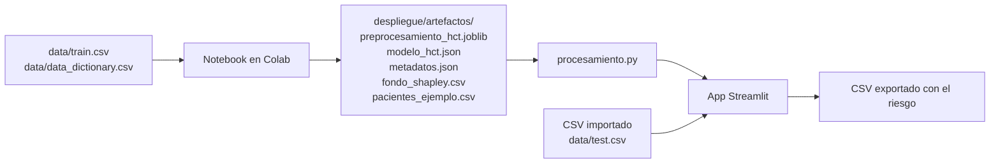

# Riesgo post trasplante: guía de instalación y despliegue

Modelo que estima, antes de un trasplante de médula ósea, la probabilidad de que el paciente tenga un evento adverso en los primeros 12 meses (la variable `efs` de la competencia, supervivencia libre de eventos: recaída, falla del injerto o muerte). El proyecto incluye el notebook de entrenamiento, los artefactos del modelo y una aplicación web en Streamlit para crear, importar, exportar y predecir pacientes, con la explicación de cada predicción.

Autor: Oscar David Perilla Dominguez (código 202624578). Especialización en Inteligencia Artificial, UPTC.

El detalle del proceso y de los resultados está en [reporteTecnico.md](reporteTecnico.md).

## Resultados principales

Cifras de la ejecución guardada del notebook, las mismas que trae `despliegue/artefactos/metadatos.json`:

| Aspecto | Resultado |
|---|---|
| Modelo | XGBClassifier ajustado con GridSearchCV (`max_depth=3`, `learning_rate=0.06`, `min_child_weight=1`, `n_estimators=400`) |
| AUC-ROC en df_test | 0.7410 |
| Recall y precision del evento | 73.3 % y 67.8 % con el umbral de 0.504 |
| Separación de riesgo | 13.1 % con evento en el decil de menor riesgo frente a 84.6 % en el de mayor riesgo |
| Pacientes del modelo desplegado | 28,562 (todo df_model) |

## Contenido del proyecto

```text
proyecto_hct_especializacion/
├── README.md                                              Esta guía
├── reporteTecnico.md                                      Reporte técnico con el proceso y los resultados
├── Proyecto_Final_ML_Riesgo_Post_Trasplante_Enviar.ipynb  Notebook de entrenamiento (Google Colab)
├── requirements.txt                                       Único archivo de dependencias (local y Streamlit Cloud)
├── .python-version                                        Versión de Python usada (3.12)
├── .streamlit/config.toml                                 Tema y configuración de la aplicación
├── data/                                                  Archivos de Kaggle: train.csv, test.csv, data_dictionary.csv
├── imagenes/                                              Figuras del notebook usadas en el reporte
└── despliegue/
    ├── app.py                   Aplicación web (Streamlit)
    ├── procesamiento.py         Limpieza igual a la del notebook, predicción, validación de CSV y explicaciones
    └── artefactos/              Generados por la sección 13 del notebook
        ├── preprocesamiento_hct.joblib   ColumnTransformer ajustado
        ├── modelo_hct.json               XGBClassifier ajustado
        ├── metadatos.json                Umbral, métricas, deciles, opciones válidas, rangos y reglas de limpieza
        ├── fondo_shapley.csv             200 pacientes de referencia para las explicaciones
        ├── pacientes_ejemplo.csv         5 pacientes reales para probar la aplicación
        └── requirements_modelo.txt       Versiones exactas de las librerías con que se entrenó
```

## Cómo fluye la información



La aplicación es la única forma de consumir el modelo: no hay API.

## 1. Datos

- Competencia: [CIBMTR, Equity in post-HCT Survival Predictions](https://www.kaggle.com/competitions/equity-post-HCT-survival-predictions/data)
- Archivos en `data/`: `train.csv` (28,800 pacientes, 60 columnas), `test.csv` (3 pacientes sin resultado), `data_dictionary.csv` y `sample_submission.csv`
- El notebook entrena con `train.csv` y toma los nombres en español a partir de `data_dictionary.csv`
- `test.csv` no sirve para evaluar porque no trae el resultado; la aplicación lo ofrece como archivo de ejemplo en la predicción por lotes

## 2. Entrenar el modelo (opcional)

Los artefactos ya están en `despliegue/artefactos/`; este paso solo hace falta para volver a generarlos.

1. Subir el notebook a Google Colab y crear la carpeta `data/` con `train.csv` y `data_dictionary.csv`
2. Ejecutar todas las celdas (Entorno de ejecución > Ejecutar todas)
3. La sección 13 crea la carpeta `artefactos/` con los seis archivos de la tabla de arriba
4. Descargarla y reemplazar `despliegue/artefactos/`

> El preprocesamiento se guarda con joblib, así que la aplicación debe usar las mismas versiones de scikit-learn, pandas, numpy y xgboost con que se entrenó. Están en `despliegue/artefactos/requirements_modelo.txt` y `requirements.txt` las repite. Si se reentrena con otras versiones, hay que copiarlas en `requirements.txt`.

## 3. Ejecutar la aplicación en local

Requiere Python 3.12. Todos los comandos se ejecutan desde la raíz del proyecto, para que Streamlit lea `.streamlit/config.toml`.

```bash
python -m venv .venv
# Windows
.venv\Scripts\activate
# macOS o Linux
source .venv/bin/activate

pip install -r requirements.txt
streamlit run despliegue/app.py
```

La aplicación abre en `http://localhost:8501`.

## 4. Uso de la aplicación

### Un paciente: crear, importar, predecir y exportar

En el panel lateral se elige el punto de partida:

| Punto de partida | Qué hace |
|---|---|
| Paciente de ejemplo | Precarga uno de los 5 pacientes reales de `pacientes_ejemplo.csv` |
| Formulario en blanco | Todos los campos vacíos para llenarlos desde cero |
| Importar CSV | Carga un archivo con uno o varios pacientes y deja elegir cuál llevar al formulario |

Después de revisar o completar los datos se pulsa **Predecir riesgo**. La predicción solo se calcula al pulsar el botón.

| Pestaña | Contenido |
|---|---|
| Paciente | Riesgo a 12 meses, nivel (bajo, intermedio o alto), alerta según el umbral, posición frente a los deciles de df_test, datos usados en la predicción y botones para exportar |
| Por qué lo predice | Gráfico de cascada con los factores que suben o bajan el riesgo de ese paciente |
| Predicción por lotes | Importa un CSV (o usa `data/test.csv` o `pacientes_ejemplo.csv`), revisa columnas y valores, predice con **Predecir lote** y exporta los resultados |
| Cómo funciona el modelo | Métricas en df_test, deciles, importancia SHAP del notebook, hiperparámetros, límites y diccionario de variables |

Los campos vacíos se completan igual que en el notebook: las variables genéticas (HLA, citogenética y epítopos de células T) quedan como `No aplica` y las demás toman la mediana o el valor más frecuente del entrenamiento. Cada campo vacío muestra qué valor se va a usar.

### Formato del CSV

- Acepta los nombres de columnas de Kaggle (los de `train.csv` y `test.csv`) o los nombres en español del notebook
- Las columnas que falten quedan como `Sin dato`; las columnas extra (`ID`, `efs`, `race_group`, etc.) se conservan en el resultado pero no se usan para predecir
- Separador coma o punto y coma (como lo guarda Excel en español)
- Hasta 30,000 filas y 50 MB por archivo
- La aplicación ofrece una plantilla vacía y avisa si hay categorías que el modelo no conoce o valores fuera del rango del entrenamiento
- El CSV exportado de un paciente usa los nombres de Kaggle, así que se puede volver a importar tal cual

Columnas que agrega la predicción:

| Columna | Significado |
|---|---|
| `riesgo_evento_12m` | Probabilidad de evento en 12 meses |
| `nivel` | Bajo hasta el riesgo medio del decil 3 de df_test (37.6 %), alto desde el del decil 8 (67.8 %) |
| `alto_riesgo` | `True` si el riesgo supera el umbral de 0.504 |
| `variables_sin_dato` | Cuántas de las 53 variables del formulario venían vacías |

### Explicabilidad

La pestaña **Por qué lo predice** solo aparece si `fondo_shapley.csv` existe, trae las 53 variables del formulario y tiene al menos 50 pacientes. Calcula valores de Shapley del modelo desplegado por muestreo de permutaciones, usando esos 200 pacientes como referencia; las 17 variables HLA se tratan como un solo factor, igual que `compatibilidad_hla` en el notebook. Las contribuciones están en puntos de probabilidad y, sumadas al riesgo de referencia, dan exactamente el riesgo del paciente. No requiere instalar la librería `shap`.

## 5. Publicar gratis en Streamlit Community Cloud

1. Subir el proyecto a un repositorio de GitHub, incluidas las carpetas `despliegue/artefactos/`, `data/` y `.streamlit/`
2. Entrar a [share.streamlit.io](https://share.streamlit.io) con la cuenta de GitHub y elegir **Create app**
3. Elegir el repositorio, la rama y como archivo principal `despliegue/app.py`
4. En **Advanced settings** elegir Python 3.12
5. **Deploy**. Streamlit instala `requirements.txt` de la raíz y aplica el tema de `.streamlit/config.toml`

```text
Repository:      usuario/proyecto_hct_especializacion
Branch:          main
Main file path:  despliegue/app.py
Python version:  3.12
```

El plan gratuito duerme la aplicación tras unos días sin visitas; al abrirla de nuevo se reactiva en cerca de un minuto. Cada `git push` a la rama vuelve a desplegarla.

## Problemas frecuentes

| Síntoma | Causa | Solución |
|---|---|---|
| `ModuleNotFoundError: procesamiento` | `procesamiento.py` no está junto a `app.py` | Mantener los dos archivos en `despliegue/` |
| La aplicación se ve sin el tema azul | Streamlit se ejecutó desde otra carpeta | Ejecutar `streamlit run despliegue/app.py` desde la raíz |
| Error al cargar `preprocesamiento_hct.joblib` o advertencia de versión | Versiones distintas de scikit-learn, pandas, numpy o xgboost | Instalar `requirements.txt` en un entorno limpio con Python 3.12 |
| No aparece la pestaña Por qué lo predice | Falta `fondo_shapley.csv` o no trae las variables del formulario | Copiar el archivo que genera la sección 13 del notebook |
| La predicción no coincide con el notebook | `limpiar_datos` de `procesamiento.py` cambió | Debe ser idéntica a la de la sección 3 del notebook |
| Aviso de valores no vistos en el entrenamiento | Una categoría del CSV no existe en los datos de Kaggle | Revisar las opciones válidas en el diccionario de la pestaña Cómo funciona el modelo |
