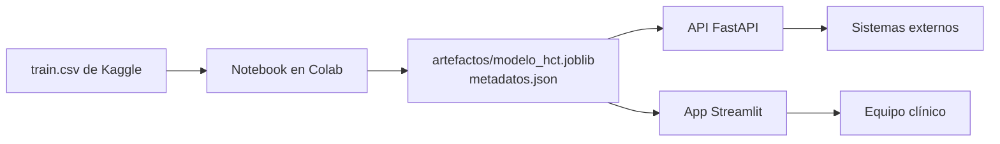

# Riesgo post trasplante: guía de despliegue

Modelo que estima, antes de un trasplante de médula ósea, la probabilidad de que el paciente tenga un evento adverso en los primeros 12 meses (la variable efs de la competencia, supervivencia libre de eventos). El proyecto incluye el notebook de entrenamiento, una API REST con FastAPI y una aplicación web con Streamlit.

Autor: [Nombre]

## Contenido del proyecto

```text
proyecto/
├── README.md                                        Esta guía
├── reporteTecnico.md                                Reporte técnico con resultados
├── Proyecto_Final_ML_Riesgo_Post_Trasplante.ipynb   Notebook de entrenamiento (Google Colab)
├── imagenes/                                        Figuras usadas en el reporte
├── data/                                            train.csv y data_dictionary.csv de Kaggle
└── despliegue/
    ├── app.py                   Aplicación web (Streamlit)
    ├── api.py                   API REST (FastAPI)
    ├── procesamiento.py         Preparación de datos y explicaciones, compartido por app y API
    ├── requirements.txt         Dependencias de la aplicación web
    ├── requirements-api.txt     Dependencias de la API
    ├── .streamlit/config.toml   Tema visual de la aplicación
    └── artefactos/              Modelo entrenado y metadatos (los genera el notebook)
```

## Cómo fluye la información



## 1. Preparar los datos

- Competencia: [CIBMTR, Equity in post-HCT Survival Predictions](https://www.kaggle.com/competitions/equity-post-HCT-survival-predictions/data)
- Archivos necesarios: `train.csv` y `data_dictionary.csv`, en la carpeta `data/` junto al notebook
- El notebook los lee directamente:

```python
df_raw = pd.read_csv("data/train.csv")
df_diccionario = pd.read_csv("data/data_dictionary.csv")
```

El `test.csv` de la competencia no se usa: solo trae 3 pacientes y no incluye el resultado.

## 2. Entrenar el modelo en Google Colab

- Subir el notebook a Colab y crear la carpeta `data/` con los dos archivos
- Ejecutar todas las celdas (Entorno de ejecución > Ejecutar todas). Tarda entre 10 y 20 minutos según la máquina asignada
- Al final se crea la carpeta `artefactos/` con:

| Archivo | Contenido |
|---|---|
| `modelo_hct.joblib` | Pipeline de scikit-learn: SimpleImputer, StandardScaler, OneHotEncoder, PCA y el modelo |
| `metadatos.json` | Umbral, métricas, nombres de variables, reglas de limpieza, opciones válidas y deciles de riesgo |
| `fondo_shapley.csv` | 200 pacientes de referencia para las explicaciones |
| `pacientes_ejemplo.csv` | 5 pacientes para probar la app y la API |
| `requirements_modelo.txt` | Versiones exactas de las librerías usadas al entrenar |

- Descargar `artefactos/` y reemplazar la carpeta `despliegue/artefactos/`

> El modelo se guarda con joblib, así que la app y la API deben usar las mismas versiones de scikit-learn, xgboost, pandas y numpy. Copie las versiones de `requirements_modelo.txt` en `requirements.txt` y `requirements-api.txt`.

## 3. Ejecutar la API en local

```bash
cd despliegue
pip install -r requirements-api.txt
uvicorn api:app --reload --port 8000
```

La documentación interactiva queda en `http://localhost:8000/docs`.

| Método | Ruta | Qué devuelve |
|---|---|---|
| GET | `/salud` | Estado de la API y nombre del modelo |
| GET | `/info` | Umbral, métricas, deciles, importancia SHAP y diccionario de variables |
| GET | `/ejemplo?indice=0` | Un paciente de ejemplo listo para enviar a `/predecir` |
| POST | `/predecir` | Riesgo a 12 meses, nivel (bajo, intermedio, alto) y si supera el umbral |
| POST | `/explicar` | Lo anterior más la contribución de cada variable al riesgo |
| POST | `/predecir/lote` | Una lista de pacientes, hasta 5,000 por solicitud |

Ejemplo de solicitud con algunos campos. Los datos se limpian igual que en el notebook: un dato genético vacío se toma como No aplica y los demás se completan con la mediana o el valor más frecuente del entrenamiento. Cada campo acepta el nombre en español o el nombre original de Kaggle (por ejemplo edad_paciente o age_at_hct):

```bash
curl -X POST http://localhost:8000/predecir \
  -H "Content-Type: application/json" \
  -d '{"edad_paciente": 62, "edad_donante": 35, "enfermedad_principal": "AML",
       "indice_riesgo_enfermedad": "High", "escala_karnofsky": 70,
       "indice_comorbilidad_sorror": 4, "intensidad_acondicionamiento": "MAC",
       "tipo_injerto": "Peripheral blood", "donante_emparentado": "Unrelated"}'
```

Respuesta:

```json
{
  "riesgo_evento_12m": 0.5145,
  "alto_riesgo": false,
  "umbral": 0.5183,
  "nivel": "Intermedio",
  "riesgo_promedio_cohorte": 0.5263,
  "variables_sin_dato": 44
}
```

Probar con un paciente completo:

```bash
curl -s http://localhost:8000/ejemplo?indice=0 > paciente.json
curl -X POST http://localhost:8000/explicar -H "Content-Type: application/json" -d @paciente.json
```

## 4. Ejecutar la aplicación web en local

```bash
cd despliegue
pip install -r requirements.txt
streamlit run app.py
```

La aplicación tiene cuatro pestañas:

- **Riesgo**: probabilidad de evento, nivel de riesgo y dónde queda el paciente frente a los deciles de la cohorte
- **Por qué lo predice**: gráfico de cascada con lo que sube y baja el riesgo de ese paciente
- **Cómo funciona el modelo**: métricas en prueba, equidad por grupo e importancia SHAP
- **Evaluar un lote**: carga de un CSV con muchos pacientes y descarga de resultados

## 5. Publicar la aplicación en Streamlit Community Cloud

1. Subir el proyecto a un repositorio de GitHub (incluida `despliegue/artefactos/`)
2. Entrar a [share.streamlit.io](https://share.streamlit.io) y elegir **Create app**
3. Seleccionar el repositorio, la rama y como archivo principal `despliegue/app.py`
4. En **Advanced settings** elegir Python 3.12 o 3.13
5. **Deploy**. Streamlit instala `despliegue/requirements.txt` y aplica el tema de `.streamlit/config.toml`

```text
Repository:      usuario/riesgo-post-trasplante
Branch:          main
Main file path:  despliegue/app.py
```

## 6. Publicar la API

Cualquier servicio que ejecute Python sirve (Render, Railway, Azure App Service). El comando de inicio es:

```bash
cd despliegue && uvicorn api:app --host 0.0.0.0 --port $PORT
```

Ejemplo de `Dockerfile` dentro de `despliegue/`:

```dockerfile
FROM python:3.12-slim
WORKDIR /app
COPY . .
RUN pip install --no-cache-dir -r requirements-api.txt
CMD ["uvicorn", "api:app", "--host", "0.0.0.0", "--port", "8000"]
```

## Problemas frecuentes

| Síntoma | Causa | Solución |
|---|---|---|
| `ModuleNotFoundError: procesamiento` | `procesamiento.py` no está junto a la app | Mantener `procesamiento.py` en la misma carpeta que `app.py` y `api.py` |
| La predicción no coincide con el notebook | La función `limpiar_datos` de `procesamiento.py` cambió | Debe ser idéntica a la de la sección 3 del notebook |
| Advertencia de versión al cargar el modelo | Versiones distintas de scikit-learn o xgboost | Usar las versiones de `requirements_modelo.txt` |
| Error 422 en la API | Un valor categórico no existe en el entrenamiento | Consultar las opciones válidas en `GET /info` |
