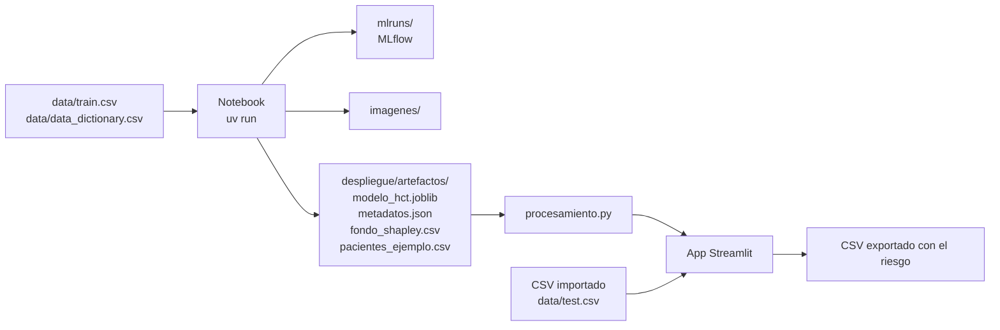

# Riesgo post trasplante: guía del proyecto

Modelo que estima, antes de un trasplante de médula ósea, la probabilidad de que el paciente tenga un evento adverso en los primeros 12 meses (la variable `efs` de la competencia, supervivencia libre de eventos: recaída, falla del injerto o muerte). El proyecto incluye el notebook de entrenamiento con todas sus salidas, el registro de experimentos en MLflow, los artefactos del modelo y una aplicación web en Streamlit para crear, importar, exportar y predecir pacientes, con la explicación de cada predicción.

Autor: Oscar David Perilla Dominguez (código 202624578). Especialización en Inteligencia Artificial, UPTC.

El detalle del proceso y de los resultados está en [reporteTecnico.md](reporteTecnico.md).

## Resultados principales

Cifras de la ejecución guardada del notebook, las mismas de `despliegue/artefactos/metadatos.json` y de MLflow:

| Aspecto | Resultado |
|---|---|
| Modelo | XGBClassifier, el mejor de seis modelos en validación cruzada de 10 pliegues (AUC 0.7349 ± 0.0062); su ventaja sobre LogisticRegression, el segundo, es significativa según la prueba de Wilcoxon (p = 0.037) |
| Hiperparámetros | GridSearchCV con 120 combinaciones: `max_depth=2`, `learning_rate=0.03`, `n_estimators=1600`, `min_child_weight=1` |
| AUC-ROC en df_test | 0.744 (intervalo de confianza del 95 %: 0.728 a 0.758) |
| Recall y precision del evento | 73.0 % y 68.1 % con el umbral de 0.507 |
| Separación de riesgo | 13.1 % con evento en el decil de menor riesgo frente a 83.7 % en el de mayor riesgo |
| Punto de referencia | Los índices clínicos usados por separado (Sorror, Karnofsky y grupo de riesgo de la enfermedad) logran un AUC de 0.565 a 0.612 |
| Pacientes del modelo desplegado | 28,562 (todo df_model) |

## Contenido del proyecto

```text
proyecto_hct_especializacion/
├── README.md                                              Esta guía
├── reporteTecnico.md                                      Reporte técnico: proceso, resultados y limitaciones
├── Proyecto_Final_ML_Riesgo_Post_Trasplante_Enviar.ipynb  Notebook de entrenamiento, con todas las salidas guardadas
├── pyproject.toml                                         Proyecto y dependencias (uv)
├── uv.lock                                                Versiones exactas de todas las librerías
├── .python-version                                        Versión de Python (3.12)
├── .streamlit/config.toml                                 Tema de la aplicación
├── data/                                                  Archivos de Kaggle: train.csv, test.csv, data_dictionary.csv
├── imagenes/                                              Figuras que guarda el notebook (las usa el reporte)
├── mlruns/                                                Registro de MLflow: mlflow.db (experimentos) y artifacts/ (gráficas, tablas y modelos)
└── despliegue/
    ├── app.py                   Aplicación web (Streamlit)
    ├── procesamiento.py         Limpieza igual a la del notebook, predicción, validación de CSV y explicaciones
    ├── requirements.txt         Dependencias de la aplicación para Streamlit Cloud, exportadas de uv.lock
    └── artefactos/              Los genera la sección 13 del notebook
        ├── modelo_hct.joblib             Pipeline completo: preprocesamiento y modelo
        ├── metadatos.json                Umbral, métricas, intervalos, comparación de modelos, deciles, importancias y reglas del formulario
        ├── fondo_shapley.csv             200 pacientes de referencia para las explicaciones de la aplicación
        ├── pacientes_ejemplo.csv         5 pacientes del dataset para probar la aplicación
        └── requirements_modelo.txt       Versiones de las librerías con que se entrenó
```

## Cómo fluye la información



## 1. Instalar uv

[uv](https://docs.astral.sh/uv/) administra la versión de Python, el entorno virtual y las librerías del proyecto. Se instala una sola vez:

```powershell
# Windows (PowerShell)
powershell -ExecutionPolicy ByPass -c "irm https://astral.sh/uv/install.ps1 | iex"
```

```bash
# macOS o Linux
curl -LsSf https://astral.sh/uv/install.sh | sh
```

Si ya tiene Python, también sirve `pip install uv`. Después de instalarlo, cierre y abra la terminal y compruebe con `uv --version`. No hace falta instalar Python aparte: uv descarga Python 3.12 si no lo encuentra (la versión está en `.python-version`).

## 2. Crear el entorno virtual

Desde la carpeta del proyecto:

```bash
uv sync
```

Este comando crea la carpeta `.venv` con Python 3.12 e instala las versiones exactas de `uv.lock`:

| Grupo | Librerías | Para qué |
|---|---|---|
| Aplicación | scikit-learn, pandas, numpy, joblib, xgboost, streamlit, plotly | Cargar el modelo y correr la aplicación |
| notebook | jupyterlab, nbconvert, matplotlib, seaborn, scipy, shap, imbalanced-learn, mlflow | Entrenar, registrar experimentos y explicar el modelo |

MLflow queda instalado con `uv sync`; no hay que instalarlo aparte. Para instalar solo lo de la aplicación: `uv sync --no-default-groups`.

> Las librerías del modelo (scikit-learn, pandas, numpy, joblib y xgboost) van con versión fija porque el modelo se guarda con joblib y solo se puede cargar con las mismas versiones con que se entrenó.

> En Windows, el Control de aplicaciones inteligente puede bloquear los ejecutables que uv crea en `.venv` (`jupyter.exe`, `streamlit.exe`, `mlflow.exe`) con el mensaje "Una directiva de Control de aplicaciones bloqueó este archivo". Por eso esta guía usa siempre la forma `uv run python -m ...`, que funciona en cualquier sistema.

## 3. Ejecutar el notebook

Abrirlo en JupyterLab:

```bash
uv run python -m jupyterlab
```

O ejecutarlo completo desde la terminal y guardar todas las salidas en el mismo archivo:

```bash
uv run python -m nbconvert --to notebook --execute --inplace Proyecto_Final_ML_Riesgo_Post_Trasplante_Enviar.ipynb
```

Con 20 núcleos tarda unos 7 minutos; la búsqueda de hiperparámetros es la parte más larga (unos 4). En equipos con menos núcleos tarda proporcionalmente más.

Qué genera:

- `imagenes/`: todas las figuras del notebook, que usa el reporte
- `despliegue/artefactos/`: el modelo y los archivos que usa la aplicación
- `mlruns/`: el registro de MLflow

El resultado se repite en cada ejecución: las versiones están fijadas en `uv.lock`, todas las fuentes de azar usan la semilla 42 (partición, pliegues, modelos, SMOTE, bootstrap y muestras de la explicabilidad) y cada modelo usa un número fijo de hilos, así que no depende de cuántos núcleos tenga el equipo.

## 4. Ver los experimentos en MLflow

MLflow guarda todo dentro del proyecto, en `mlruns/`: la base de datos de los experimentos (`mlruns/mlflow.db`) y los archivos (`mlruns/artifacts/`). Para verlos:

```bash
uv run python -m mlflow ui --backend-store-uri sqlite:///mlruns/mlflow.db --port 5000
```

Y abrir http://127.0.0.1:5000. En el experimento `riesgo_post_trasplante` aparecen estos runs:

| Run | Qué registra |
|---|---|
| datos_y_analisis_exploratorio | Tamaño de los datos y de la partición, los tres conjuntos (df_train, df_val y df_test) y las figuras del análisis exploratorio |
| experimento_imputacion, experimento_pca, experimento_smote | Cada variante como un run anidado, con su AUC en df_val |
| comparacion_modelos | Los seis modelos (un run anidado por modelo) con la media y la desviación de cada métrica en 10 pliegues, la gráfica de cajas y la prueba de Wilcoxon |
| gridsearch \| modelo | Cada combinación de hiperparámetros como un run anidado, con su AUC; el mapa de calor y la tabla completa |
| modelo_final \| modelo | Hiperparámetros, umbral, métricas en df_val y df_test con intervalos de confianza, todas las gráficas de evaluación y explicabilidad, y el modelo |
| modelo_despliegue \| modelo | El modelo reentrenado con todos los pacientes, registrado como `riesgo_post_trasplante` (pestaña Models), y una copia de los artefactos |

Cada ejecución del notebook agrega runs nuevos, marcados con la etiqueta `ejecucion`. Para empezar de cero, se borra la carpeta `mlruns/` antes de ejecutar. Las rutas de los archivos quedan guardadas como rutas absolutas: si se mueve la carpeta del proyecto, la interfaz muestra los runs pero puede no encontrar sus archivos hasta volver a ejecutar el notebook.

## 5. Ejecutar la aplicación en local

Desde la raíz del proyecto, para que Streamlit lea `.streamlit/config.toml`:

```bash
uv run python -m streamlit run despliegue/app.py
```

La aplicación abre en http://localhost:8501.

## 6. Uso de la aplicación

### Un paciente: crear, importar, predecir y exportar

En el panel lateral se elige el punto de partida:

| Punto de partida | Qué hace |
|---|---|
| Paciente de ejemplo | Precarga uno de los 5 pacientes de `pacientes_ejemplo.csv` |
| Formulario en blanco | Todos los campos vacíos para llenarlos desde cero |
| Importar CSV | Carga un archivo con uno o varios pacientes y deja elegir cuál llevar al formulario |

Después de revisar o completar los datos se pulsa **Predecir riesgo**. La predicción solo se calcula al pulsar el botón.

| Pestaña | Contenido |
|---|---|
| Paciente | Riesgo a 12 meses, nivel (bajo, intermedio o alto), alerta según el umbral, posición frente a los deciles de df_test, datos usados en la predicción y botones para exportar |
| Por qué lo predice | Gráfico de cascada con los factores que suben o bajan el riesgo de ese paciente |
| Predicción por lotes | Importa un CSV (o usa `data/test.csv` o `pacientes_ejemplo.csv`), revisa columnas y valores, predice con **Predecir lote** y exporta los resultados |
| Cómo funciona el modelo | Métricas en df_test con intervalos de confianza, comparación de los seis modelos, deciles, importancia de las variables (SHAP y permutación), hiperparámetros, límites y diccionario de variables |

Los campos vacíos se completan igual que en el notebook: las variables genéticas (HLA, citogenética y epítopos de células T) quedan como `No aplica` y las demás toman la mediana o el valor más frecuente del entrenamiento. Cada campo vacío muestra qué valor se va a usar.

### Formato del CSV

- Acepta los nombres de columnas de Kaggle (los de `train.csv` y `test.csv`) o los nombres en español del notebook
- Las columnas que falten quedan como `Sin dato`; las columnas extra (`ID`, `efs`, `race_group`, etc.) se conservan en el resultado pero no se usan para predecir
- Separador coma o punto y coma (como lo guarda Excel en español)
- Hasta 30,000 filas y 50 MB por archivo
- La aplicación ofrece una plantilla vacía y avisa si hay categorías que el modelo no conoce o valores fuera del rango del entrenamiento
- El CSV exportado de un paciente usa los nombres de Kaggle, así que se puede volver a importar tal cual

Columnas que agrega la predicción:

| Columna | Significado |
|---|---|
| `riesgo_evento_12m` | Probabilidad de evento en 12 meses |
| `nivel` | Bajo hasta el riesgo medio del decil 3 de df_test (37.4 %), alto desde el del decil 8 (68.2 %) |
| `alto_riesgo` | `True` si el riesgo supera el umbral de 0.507 |
| `variables_sin_dato` | Cuántas de las 53 variables del formulario venían vacías |

### Explicabilidad en la aplicación

La pestaña **Por qué lo predice** solo aparece si `fondo_shapley.csv` existe, trae las 53 variables del formulario y tiene al menos 50 pacientes. Calcula valores de Shapley del modelo desplegado por muestreo de permutaciones, usando esos 200 pacientes como referencia; las 17 variables HLA se tratan como un solo factor, igual que `compatibilidad_hla` en el notebook. Las contribuciones están en puntos de probabilidad y, sumadas al riesgo de referencia, dan exactamente el riesgo del paciente.

## 7. Publicar gratis en Streamlit Community Cloud

Streamlit Cloud busca el archivo de dependencias primero en la carpeta del archivo principal y luego en la raíz. Por eso la aplicación tiene su propio `despliegue/requirements.txt`, con solo las librerías de la aplicación (sin las del notebook), exportado de `uv.lock` para que las versiones sean las mismas que en local.

1. Subir el proyecto a un repositorio de GitHub, incluidas las carpetas `despliegue/`, `data/` y `.streamlit/`
2. Entrar a [share.streamlit.io](https://share.streamlit.io) con la cuenta de GitHub y elegir **Create app**
3. Elegir el repositorio, la rama y como archivo principal `despliegue/app.py`
4. En **Advanced settings** elegir Python 3.12
5. **Deploy**. Streamlit instala `despliegue/requirements.txt` y aplica el tema de `.streamlit/config.toml`

```text
Repository:      usuario/proyecto_hct_especializacion
Branch:          main
Main file path:  despliegue/app.py
Python version:  3.12
```

El plan gratuito duerme la aplicación tras unos días sin visitas; al abrirla de nuevo se reactiva en cerca de un minuto. Cada `git push` a la rama vuelve a desplegarla. La carpeta `mlruns/` no se necesita para el despliegue.

## 8. Actualizar dependencias

```bash
uv add nombre-paquete                      # librería de la aplicación
uv add --group notebook nombre-paquete     # librería solo para el notebook
uv lock --upgrade-package nombre-paquete   # subir de versión una librería
uv export --no-default-groups --no-hashes --no-emit-project -o despliegue/requirements.txt
```

El último comando vuelve a generar las dependencias de Streamlit Cloud y debe ejecutarse después de cualquier cambio. Si se cambia la versión de scikit-learn, pandas, numpy, joblib o xgboost, hay que volver a ejecutar el notebook para regenerar `modelo_hct.joblib`.

## Problemas frecuentes

| Síntoma | Causa | Solución |
|---|---|---|
| `uv` no se reconoce como comando | La terminal se abrió antes de instalar uv | Cerrar y abrir la terminal |
| "Una directiva de Control de aplicaciones bloqueó este archivo" | Windows bloquea los ejecutables de `.venv` | Usar `uv run python -m jupyterlab`, `uv run python -m streamlit` y `uv run python -m mlflow` |
| `ModuleNotFoundError: procesamiento` | `procesamiento.py` no está junto a `app.py` | Mantener los dos archivos en `despliegue/` |
| La aplicación se ve sin el tema | Streamlit se ejecutó desde otra carpeta | Ejecutarla desde la raíz del proyecto |
| Error al cargar `modelo_hct.joblib` | Versiones distintas de scikit-learn, pandas, numpy o xgboost | Ejecutar `uv sync` (o instalar `despliegue/requirements.txt`) en un entorno limpio con Python 3.12 |
| La interfaz de MLflow no muestra las gráficas | Se movió la carpeta del proyecto | Volver a ejecutar el notebook (o borrar `mlruns/` y ejecutarlo) |
| No aparece la pestaña Por qué lo predice | Falta `fondo_shapley.csv` o no trae las variables del formulario | Volver a generar los artefactos con la sección 13 del notebook |
| La predicción no coincide con el notebook | `limpiar_datos` de `procesamiento.py` cambió | Debe ser idéntica a la de la sección 3 del notebook |
