# Reporte técnico: riesgo de evento en el primer año después de un trasplante de médula ósea

Proyecto final de la materia de Aprendizaje Automático. Especialización en Inteligencia Artificial, Universidad Pedagógica y Tecnológica de Colombia.

Autor: Oscar David Perilla Dominguez (código 202624578)

Todas las cifras salen de la ejecución guardada del notebook `Proyecto_Final_ML_Riesgo_Post_Trasplante_Enviar.ipynb`, ejecutado en local con el entorno de uv, y coinciden con `despliegue/artefactos/metadatos.json` y con el registro de MLflow (`mlruns/`). Las instrucciones de instalación, ejecución y despliegue están en [README.md](README.md).

## Resumen

| Aspecto | Resultado |
|---|---|
| Pregunta | ¿Tendrá el paciente un evento adverso en los primeros 12 meses después del trasplante? |
| Datos | 28,800 pacientes y 57 variables registradas antes del trasplante (datos sintéticos de la competencia CIBMTR en Kaggle) |
| Tipo de problema | Clasificación binaria, convertida desde un problema de tiempo hasta el evento |
| Modelo final | XGBClassifier, el mejor de seis modelos, ajustado con GridSearchCV |
| AUC en df_test | 0.744 (intervalo de confianza del 95 %: 0.728 a 0.758) |
| Recall y precision del evento | 73.0 % y 68.1 % con el umbral de 0.507 |
| Separación de riesgo | 13.1 % de pacientes con evento en el decil de menor riesgo frente a 83.7 % en el de mayor riesgo |
| Explicabilidad | SHAP e importancia por permutación en el notebook; valores de Shapley por paciente en la aplicación |
| Seguimiento | MLflow: experimentos, comparación de modelos, cada combinación de la búsqueda, métricas, gráficas y modelo registrado |
| Despliegue | Aplicación Streamlit, local o en Streamlit Community Cloud |

## 1. Problema

El trasplante alogénico de células hematopoyéticas (HCT, conocido como trasplante de médula ósea) reemplaza la médula enferma por células sanas de un donante. Puede curar leucemias y otras enfermedades graves de la sangre, pero más de la mitad de los pacientes tiene un evento adverso en el primer año.

Qué es el evento: el diccionario de la competencia llama a la variable resultado `efs`, supervivencia libre de eventos. Un paciente con `efs = 1` tuvo un evento grave después del trasplante (en trasplante este indicador agrupa sucesos como la recaída de la enfermedad, la falla del injerto o la muerte). `efs_time` dice cuántos meses pasaron hasta ese evento o hasta el último control.

El modelo estima el riesgo de cada paciente antes del trasplante para:

- Priorizar a los pacientes que necesitan un seguimiento más estrecho
- Revisar a tiempo alternativas de donante y de tratamiento
- Explicar al paciente y a su familia de qué depende su riesgo

### Cómo se mide el éxito

La métrica principal es el AUC-ROC, porque la decisión es a quién vigilar primero y el AUC mide justo eso: si el modelo pone primero a quien de verdad tiene más riesgo, sin depender del umbral de alerta, que se fija después.

| Métrica | Pregunta de negocio que responde |
|---|---|
| AUC-ROC | Si tomo un paciente que tuvo el evento y otro que no, ¿con qué frecuencia el modelo le da más riesgo al primero? 0.5 es lanzar una moneda y 1.0 es acertar siempre |
| Recall del evento | De cada 100 pacientes que tendrán un evento, ¿a cuántos les llega una alerta? |
| Precision del evento | De cada 100 alertas, ¿cuántas son correctas? |
| Calibración, Brier y log-loss | ¿Un riesgo de 30 % significa de verdad 3 de cada 10 pacientes? |

## 2. Datos y diccionario

- Fuente: competencia CIBMTR, Equity in post-HCT Survival Predictions, de Kaggle. Son datos sintéticos: el CIBMTR los generó a partir de su registro real para proteger la privacidad de los pacientes, así que reproducen sus patrones pero no corresponden a personas reales
- Archivos en la carpeta `data/`: `train.csv` (28,800 pacientes, 60 columnas), `data_dictionary.csv`, `test.csv` y `sample_submission.csv`
- El `test.csv` de la competencia no se usa para evaluar: trae 3 pacientes sin resultado, porque Kaggle guarda las respuestas en privado. La aplicación lo ofrece como archivo de ejemplo para la predicción por lotes
- Diccionario de variables: https://www.kaggle.com/competitions/equity-post-HCT-survival-predictions/data
- Códigos de enfermedad: https://www.manula.com/manuals/cibmtr/formsnet3-training-guide/1/en/topic/disease-codes

Ejemplos del cambio de nombres a partir del diccionario oficial:

| Nombre original | Nombre nuevo | Descripción oficial |
|---|---|---|
| `age_at_hct` | `edad_paciente` | Age at HCT |
| `comorbidity_score` | `indice_comorbilidad_sorror` | Sorror comorbidity score |
| `karnofsky_score` | `escala_karnofsky` | KPS at HCT |
| `dri_score` | `indice_riesgo_enfermedad` | Refined disease risk index |
| `conditioning_intensity` | `intensidad_acondicionamiento` | Computed planned conditioning intensity |
| `gvhd_proph` | `profilaxis_injerto_huesped` | Planned GVHD prophylaxis |
| `sex_match` | `sexo_donante_receptor` | Donor/recipient sex match |
| `hla_match_drb1_low` | `hla_drb1_baja_res` | Recipient / 1st donor antigen level (low resolution) matching at HLA-DRB1 |

Las leucemias agudas (ALL con 8,102 pacientes y AML con 7,135) y el síndrome mielodisplásico (3,046) suman más de la mitad de los pacientes.

### Variables principales en lenguaje de negocio

| Variable | Qué significa |
|---|---|
| Escala de Karnofsky | Estado funcional del paciente, de 0 a 100. 100 es una vida normal sin síntomas |
| Índice de comorbilidad de Sorror | Suma ponderada de otras enfermedades del paciente. Más puntos, más fragilidad |
| Índice de riesgo de la enfermedad | Qué tan agresiva es la enfermedad que motiva el trasplante |
| Intensidad del acondicionamiento | Qué tan fuerte es la quimioterapia o radiación previa. MAC es intensa, RIC de intensidad reducida y NMA no mieloablativa |
| Profilaxis injerto contra huésped | Medicamentos para evitar que las células del donante ataquen al paciente |
| Compatibilidad HLA | Parecido entre los marcadores genéticos del sistema inmune del paciente y del donante |
| Citogenética | Alteraciones en los cromosomas de las células enfermas, que indican qué tan agresiva es la enfermedad |
| Sexo donante y receptor | Combinación de sexos, por ejemplo F-M es donante mujer y receptor hombre |

## 3. Calidad y limpieza: de df_raw a df_clean

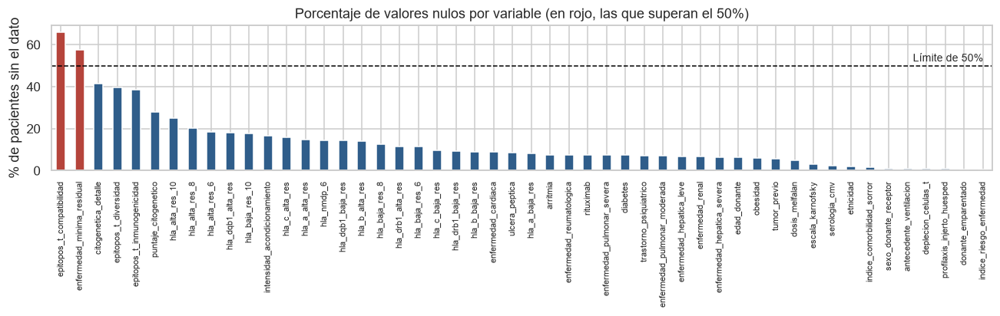

- No hay filas ni pacientes duplicados; hay 35 variables categóricas y 25 numéricas
- Dos variables superan el 50 % de nulos y se eliminan: compatibilidad de epítopos de células T (66.0 %) y enfermedad mínima residual (57.6 %)
- En las 21 variables genéticas que quedan (17 HLA, 2 de citogenética y 2 de epítopos de células T), un nulo se marca como `No aplica`, entre 8.3 % y 41.4 % de los pacientes según la variable: si el dato no está, lo más probable es que la prueba no se hizo o no correspondía, así que llenarlo con un promedio inventaría un resultado genético
- Se crean cinco variables nuevas: diferencia de edad donante-paciente, paciente pediátrico, número de comorbilidades, si recibió irradiación corporal total y el índice de riesgo de la enfermedad agrupado en seis grupos (Bajo, Intermedio, Alto, Muy alto, No aplica y Pendiente)
- df_clean queda con 62 columnas (60 originales, menos 2 eliminadas, más 5 nuevas, menos el índice de riesgo original)

```python
def limpiar_datos(df, columnas_eliminadas, variables_geneticas):
    df = df.rename(columns=NOMBRES).drop(columns=columnas_eliminadas, errors="ignore")
    for c in variables_geneticas:
        if c in df.columns:
            texto = df[c].map(lambda v: f"{v:g}" if isinstance(v, (int, float)) and not pd.isna(v) else v)
            df[c] = texto.fillna("No aplica").astype(str)
    df["dif_edad_donante"] = df["edad_donante"] - df["edad_paciente"]
    df["es_pediatrico"] = (df["edad_paciente"] < 18).astype(int)
    df["n_comorbilidades"] = (df[COMORBILIDADES] == "Yes").sum(axis=1)
    df["recibio_irradiacion"] = (df["irradiacion_corporal_total"] != "No TBI").astype(int)
    df["grupo_riesgo_enfermedad"] = df["indice_riesgo_enfermedad"].map(GRUPO_RIESGO).fillna(df["indice_riesgo_enfermedad"])
    return df.drop(columns=["indice_riesgo_enfermedad"])
```

Todas las reglas se aplican fila por fila y no usan la variable objetivo. Los nulos que quedan (28 variables, casi todas con menos de 10 %) se imputan dentro del Pipeline. La función está en la sección 3 del notebook y una copia exacta en `despliegue/procesamiento.py`, que es la que usa la aplicación.

## 4. De tiempo hasta el evento a clasificación, y partición

El resultado original es el tiempo en meses hasta el evento, una variable continua parecida a una regresión. El problema es la censura: a muchos pacientes se les dejó de observar sin haber tenido el evento, así que no se conoce su tiempo real. Se convierte en una pregunta de sí o no:

```text
evento_12m = 1   si el paciente tuvo el evento en los primeros 12 meses
evento_12m = 0   si tuvo el evento después, o si se le siguió 12 meses o más sin evento
excluido         si no tuvo el evento pero salió del seguimiento antes de los 12 meses
```

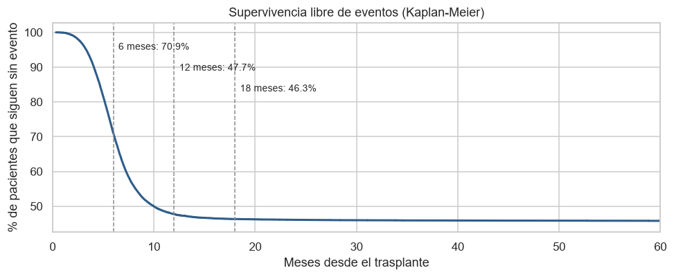

- La decisión clínica es binaria: seguimiento intensivo o habitual
- De los 15,532 pacientes con evento, el 96.8 % lo tuvo antes de los 12 meses (mediana de 5.8 meses)
- Sin evento siguen el 70.9 % a los 6 meses, el 47.7 % a los 12 y el 46.3 % a los 18
- Solo se excluyen 238 pacientes (0.8 %); df_model queda con 28,562 pacientes y 57 predictores, 52.6 % con evento y 47.4 % sin evento
- El grupo racial y la etnicidad no se usan como predictores; solo sirven para estratificar la partición

Partición 70/15/15, estratificada por objetivo y grupo racial, antes de cualquier paso que aprenda de los datos:

| Conjunto | Pacientes | Con evento | Sin evento | Para qué se usa |
|---|---|---|---|---|
| df_train | 19,992 | 52.62 % | 47.38 % | Comparación de modelos y búsqueda de hiperparámetros con validación cruzada |
| df_val | 4,285 | 52.65 % | 47.35 % | Decisiones fuera de la validación cruzada: imputación, PCA, SMOTE, comprobación del modelo ajustado y umbral de alerta |
| df_test | 4,285 | 52.65 % | 47.35 % | Evaluación final, una sola vez |

Por qué 70/15/15 con 28,562 pacientes: df_test es lo bastante grande para medir el AUC con un margen de unos 0.015 hacia cada lado (sección 9), y df_val permite tomar varias decisiones sin usar df_test. Calculada solo con df_train, la regla de más de 50 % de nulos elimina las mismas dos variables, así que haberla calculado con todos los pacientes no le pasa información de df_val ni de df_test al modelo.

## 5. Hallazgos del análisis exploratorio

Todo el análisis usa solo df_train.

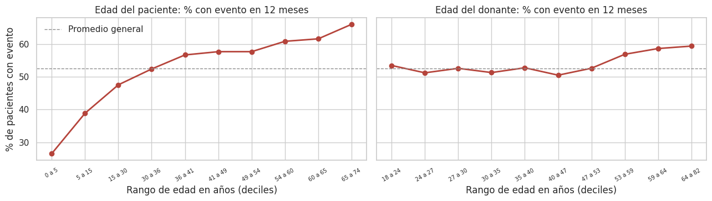

- El riesgo sube con la edad del paciente: 26 % en niños de 0 a 5 años, 52 % (el promedio) entre 30 y 36 años y 66 % en mayores de 65
- La edad del donante pesa poco hasta los 53 años y sube a 57 % o 59 % con donantes mayores

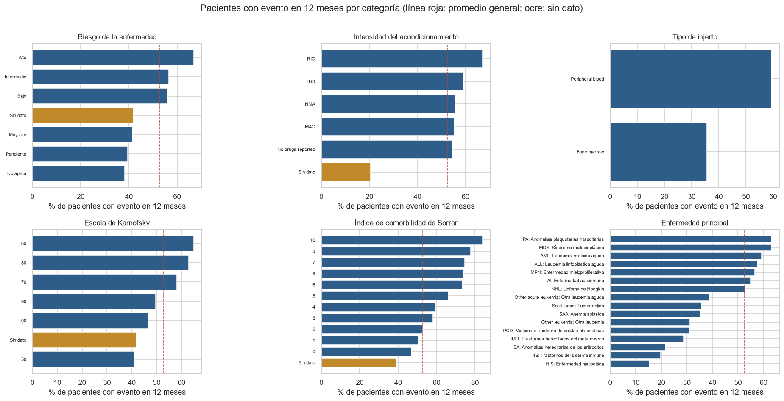

- Riesgo de la enfermedad alto: 66 % con evento; la categoría Muy alto queda por debajo del promedio (41 %)
- Acondicionamiento de intensidad reducida (RIC): 67 %, frente a 55 % del intenso (MAC)
- Sangre periférica: 60 %, frente a 35 % de la médula ósea
- Índice de Sorror: de 47 % con 0 puntos a 84 % con 10
- Escala de Karnofsky: no sigue un orden perfecto (50 tiene menos eventos que 60 u 80)
- Los pacientes sin dato (barras ocre) tienen menos riesgo que el promedio; sin dato de intensidad solo el 20 % tiene evento

### Compatibilidad HLA

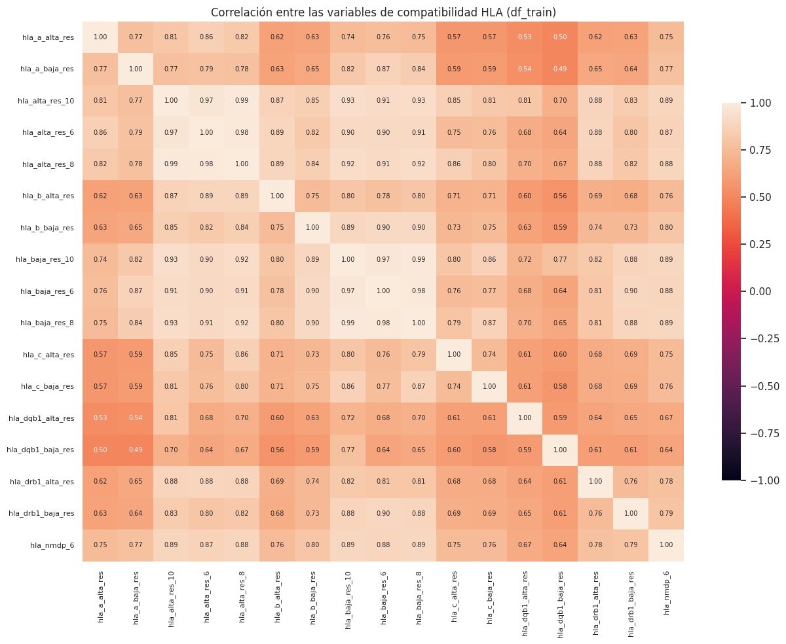

- Correlación media de 0.763 entre pares de variables HLA (mínima 0.494); las que resumen varios genes llegan a 0.99
- El 20.1 % de los pacientes no tiene `hla_alta_res_8` y su porcentaje con evento (51.7 %) es casi igual al de quienes sí lo tienen (52.9 %)

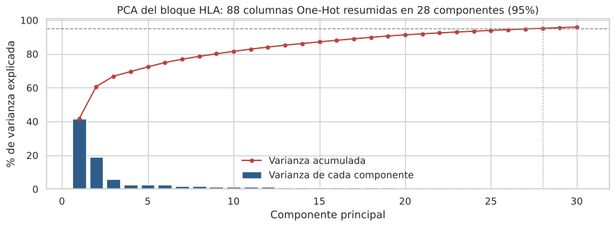

- Con One-Hot el bloque HLA pasa a 88 columnas; el primer componente explica el 41.6 % y 28 componentes conservan el 95 % de la varianza

### Datos vacíos y año del trasplante

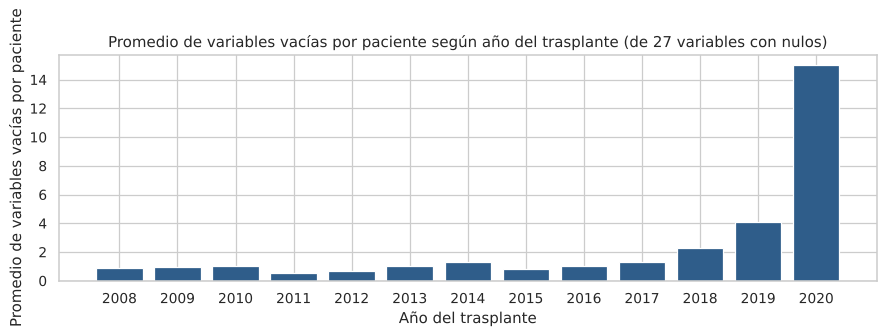

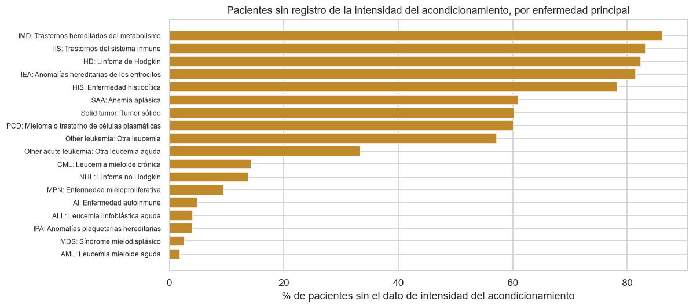

- Entre 2008 y 2017 cada paciente tiene alrededor de una variable vacía de las 27 que aún pueden tener nulos; sube a 2.3 en 2018 y 4.1 en 2019. La barra de 2020 llega a 15, pero ese año solo tiene 2 pacientes en df_train
- A los pacientes pediátricos les falta la intensidad del acondicionamiento en el 47.9 % de los casos, frente al 7.4 % en adultos
- En varias enfermedades hereditarias o no malignas (IMD, IIS, IEA, HIS) el dato falta en el 78 % o más, y en el 82 % de los pocos casos de linfoma de Hodgkin; en AML, MDS o ALL en menos del 5 %. No pasa en todas: a las anomalías plaquetarias hereditarias casi nunca les falta
- No es abandono del seguimiento: los pacientes sin evento tienen entre 35.9 y 39.5 meses de seguimiento en mediana con 0 a 5 variables vacías; el grupo con 6 o más tiene 27.3 meses porque coincide con los trasplantes más recientes
- Sí es un sesgo: en los adultos, el 61.0 % de quienes tienen el dato de intensidad tuvo un evento, frente al 23.6 % de quienes no lo tienen; en los niños, 48.4 % frente a 18.9 %

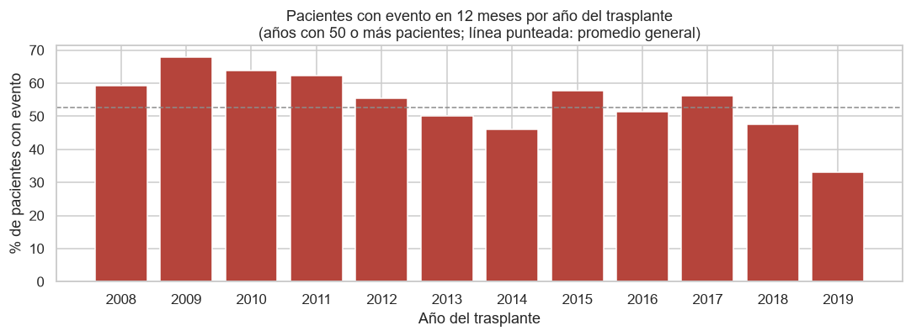

- Hasta 2017 el porcentaje con evento sube y baja entre 46 % y 68 % sin una tendencia clara; en 2018 baja a 47.5 % y en 2019 a 33.0 %, los mismos años con más datos vacíos. Con estos datos no se puede saber si la caída se debe a mejores tratamientos o a registros todavía incompletos

## 6. Preparación de datos

Todo el preprocesamiento usa clases estándar de scikit-learn dentro de un Pipeline:

```python
columnTransformer = ColumnTransformer([
    ("hla", Pipeline([("oneHotEncoder", OneHotEncoder(handle_unknown="infrequent_if_exist", min_frequency=20, sparse_output=False)),
                      ("pca", PCA(n_components=0.95, svd_solver="full", random_state=42))]), COLUMNAS_HLA),
    ("num", Pipeline([("simpleImputer", SimpleImputer(strategy="median")), ("standardScaler", StandardScaler())]), COLUMNAS_NUMERICAS),
    ("cat", Pipeline([("simpleImputer", SimpleImputer(strategy="most_frequent")),
                      ("oneHotEncoder", OneHotEncoder(handle_unknown="infrequent_if_exist", min_frequency=20, sparse_output=False))]),
     COLUMNAS_CATEGORICAS),
])
pipelineFinal = Pipeline([("columnTransformer", columnTransformer), ("modelo", XGBClassifier(...))])
```

Por qué todo va dentro del Pipeline: la imputación, el escalado, el One-Hot y el PCA aprenden algo de los datos (la mediana, la media y la desviación, las categorías y los componentes). Si se ajustaran una sola vez con todos los pacientes antes de la validación cruzada, esos valores incluirían a los pacientes con los que después se mide el modelo, y el resultado saldría mejor de lo real. Dentro del Pipeline, en cada pliegue los pasos aprenden solo de los datos de entrenamiento. Por la misma razón, el PCA no fija 28 componentes: conserva el 95 % de la varianza y cada ajuste calcula cuántos necesita.

El modelo recibe 57 predictores (17 HLA, 9 numéricos y 31 categóricos) que se convierten en 181 columnas.

### Imputación

Cambio de riesgo con vacíos: diferencia en el riesgo promedio al borrar la intensidad del acondicionamiento, la escala de Karnofsky y el índice de Sorror a 3,447 pacientes completos de df_val.

| Modelo | SimpleImputer | AUC en df_val | Cambio de riesgo con vacíos |
|---|---|---|---|
| LogisticRegression | constant (No informado) | 0.7397 | -21.8 puntos |
| LogisticRegression | most_frequent | 0.7369 | -5.4 puntos |
| XGBClassifier | constant (No informado) | 0.7407 | -31.4 puntos |
| XGBClassifier | most_frequent | 0.7378 | -6.7 puntos |

Se elige `most_frequent`: cuesta 0.003 de AUC y reduce mucho el premio a los formularios incompletos, aunque no lo elimina del todo.

### Reducción de dimensión

Con LogisticRegression en df_val:

| Variante | Columnas | AUC en df_val |
|---|---|---|
| Sin PCA | 241 | 0.7377 |
| PCA solo en HLA (95 % de varianza) | 181 | 0.7369 |
| PCA sobre todas las columnas (95 % de varianza) | 72 | 0.7315 |

Se usa PCA solo en el bloque HLA: quita 60 columnas con una pérdida mínima de AUC.

### Balanceo de clases: prueba con SMOTE

Con 52.6 % y 47.4 % las clases están casi balanceadas. Se probó SMOTE dentro de un Pipeline de imbalanced-learn (solo actúa al entrenar):

| Modelo | Cambio en AUC | Cambio en F1 macro | Recall del evento sin SMOTE | Recall del evento con SMOTE |
|---|---|---|---|---|
| LogisticRegression | -0.0001 | +0.0009 | 0.739 | 0.693 |
| XGBClassifier | +0.0014 | +0.0007 | 0.750 | 0.741 |

La mejora es tan pequeña que no compensa agregar pacientes sintéticos al entrenamiento, así que no se usa SMOTE; el equilibrio entre eventos detectados y alertas se ajusta con el umbral.

## 7. Comparación de modelos

Seis modelos con el mismo Pipeline, evaluados con StratifiedKFold de 10 pliegues sobre df_train (KNN con un PCA global adicional):

- Estratificada: cada pliegue conserva la proporción de 52.6 % y 47.4 %, así todos los pliegues son comparables
- 10 pliegues: cada pliegue de validación tiene unos 2,000 pacientes, suficientes para un AUC estable, y da 10 valores por modelo para la prueba de Wilcoxon. Todos los modelos usan los mismos pliegues
- Sin partición por fechas: el objetivo no es pronosticar años futuros, y los años recientes tienen pocos pacientes y registros incompletos. Queda como limitación

| Modelo | AUC | Average precision | F1 macro | Balanced accuracy | Log-loss | Segundos por ajuste |
|---|---|---|---|---|---|---|
| XGBClassifier | 0.7349 ± 0.0062 | 0.7407 ± 0.0076 | 0.6719 ± 0.0048 | 0.6721 ± 0.0047 | 0.6019 ± 0.0052 | 2.5 |
| LogisticRegression | 0.7314 ± 0.0073 | 0.7373 ± 0.0099 | 0.6660 ± 0.0086 | 0.6660 ± 0.0084 | 0.6048 ± 0.0065 | 1.1 |
| HistGradientBoostingClassifier | 0.7283 ± 0.0060 | 0.7334 ± 0.0089 | 0.6650 ± 0.0047 | 0.6651 ± 0.0046 | 0.6073 ± 0.0050 | 4.6 |
| AdaBoostClassifier | 0.7265 ± 0.0078 | 0.7348 ± 0.0084 | 0.6610 ± 0.0110 | 0.6616 ± 0.0107 | 0.6376 ± 0.0024 | 17.6 |
| RandomForestClassifier | 0.7183 ± 0.0101 | 0.7236 ± 0.0122 | 0.6548 ± 0.0105 | 0.6559 ± 0.0102 | 0.6176 ± 0.0058 | 6.3 |
| KNeighborsClassifier | 0.6952 ± 0.0104 | 0.6965 ± 0.0112 | 0.6424 ± 0.0133 | 0.6429 ± 0.0130 | 0.6320 ± 0.0064 | 1.1 |

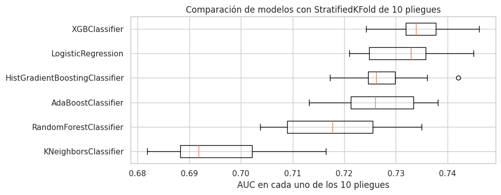

Prueba de Wilcoxon pareada (AUC del mejor frente a cada uno de los otros en los mismos 10 pliegues):

| Modelo comparado | Diferencia media de AUC | Pliegues en que gana XGBClassifier | p-valor |
|---|---|---|---|
| LogisticRegression | 0.0035 | 8 de 10 | 0.037 |
| HistGradientBoostingClassifier | 0.0066 | 10 de 10 | 0.002 |
| AdaBoostClassifier | 0.0084 | 10 de 10 | 0.002 |
| RandomForestClassifier | 0.0166 | 10 de 10 | 0.002 |
| KNeighborsClassifier | 0.0397 | 10 de 10 | 0.002 |

Se elige XGBClassifier: tiene el mayor AUC medio y su ventaja sobre todos los demás es significativa (p < 0.05). La diferencia con LogisticRegression es pequeña, así que la regresión logística queda como una alternativa más simple con un desempeño cercano.

## 8. Ajuste de hiperparámetros con GridSearchCV

El mejor modelo se ajusta con GridSearchCV. Por qué este método: se ajusta un solo modelo y cuatro hiperparámetros con pocos valores cada uno, así que probar todas las combinaciones (120) es viable; es exhaustivo y reproducible, y permite ver cómo cambia el AUC con cada hiperparámetro. Validación: StratifiedKFold de 5 pliegues sobre df_train (unos 4,000 pacientes por pliegue de validación; la mitad de ajustes que con 10).

| Hiperparámetro | Valores | Escala | Por qué |
|---|---|---|---|
| max_depth | 1, 2, 3, 4, 5 | lineal | Profundidad de cada árbol: cuántas variables puede combinar una regla. Más profundidad capta más interacciones, pero se sobreajusta con más facilidad |
| learning_rate | 0.03, 0.06, 0.12 | logarítmica (cada valor duplica al anterior) | Cuánto aporta cada árbol; su efecto es relativo |
| n_estimators | 200, 400, 800, 1,600 | logarítmica (cada valor duplica al anterior) | Número de árboles; va de la mano con learning_rate |
| min_child_weight | 1, 10 | logarítmica | Peso mínimo de pacientes en cada hoja; 1 es el valor por defecto de XGBoost y 10 obliga a reglas más generales |

`subsample` (0.9) y `colsample_bytree` (0.8) quedan fijos en la configuración de partida. Los valores extienden esa configuración (max_depth 4, learning_rate 0.05, 300 árboles) hacia los dos lados.

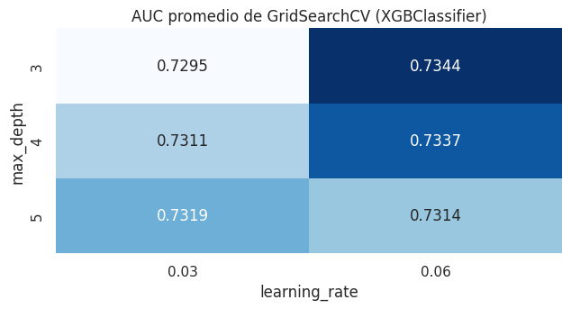

- Mejor combinación: profundidad 2, tasa de aprendizaje 0.03, peso mínimo por hoja 1 y 1,600 árboles, con AUC de 0.7376. Las ocho mejores combinaciones quedan entre 0.7362 y 0.7376: cerca del óptimo el modelo es poco sensible a los hiperparámetros
- Tres valores quedan en un borde de la grilla, sin que haga falta seguir buscando: learning_rate y n_estimators se compensan (0.03 con 1,600 árboles da 0.7376; 0.06 con 800, 0.7372; 0.12 con 400, 0.7367; la diferencia es menor que la variación entre pliegues, de 0.005), y min_child_weight = 1 es el valor por defecto, con 10 casi igual (0.7374)
- max_depth = 2 quedó dentro de la grilla: con profundidad 1 y 3 el AUC es menor
- Con árboles poco profundos conviene una tasa de aprendizaje más alta y con árboles profundos una más baja; la peor combinación es profundidad 5 con 0.12 (0.7131)
- AUC de entrenamiento del mejor candidato: 0.7840, un sobreajuste moderado
- En df_val: AUC 0.7425 frente a 0.7411 sin ajustar; el ajuste mejora poco, como anticipaba la grilla
- Umbral de alerta por índice de Youden en df_val: 0.507 (recall 0.734, precision 0.683), fijado antes de ver df_test

## 9. Evaluación final en df_test

df_test (4,285 pacientes) se usa una sola vez, con el modelo y el umbral ya decididos.

| Métrica | Valor en df_test | Intervalo de confianza del 95 % (bootstrap, 1,000 remuestreos) |
|---|---|---|
| AUC-ROC | 0.7441 | 0.728 a 0.758 |
| Recall del evento | 0.7296 | 0.711 a 0.748 |
| Precision del evento | 0.6813 | 0.662 a 0.700 |
| Average precision | 0.7469 | |
| F1 macro | 0.6753 | |
| Balanced accuracy | 0.6751 | |
| Brier score | 0.2039 (0.25 es predecir siempre 50 %) | |
| Log-loss | 0.5928 (0.693 es predecir siempre 50 %) | |

El AUC en df_test está en línea con la validación cruzada (0.7376) y con df_val (0.7425): el resultado es estable.

Punto de referencia: usados por sí solos, el índice de Sorror logra un AUC de 0.569, la escala de Karnofsky 0.565 y el grupo de riesgo de la enfermedad 0.612, frente a 0.744 del modelo.

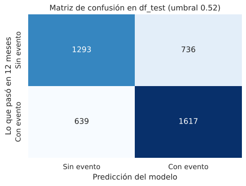

- De los 2,256 pacientes con evento, el modelo alertó a 1,646 y no detectó a 610
- De los 2,029 sin evento, 1,259 quedaron bien clasificados y 770 recibieron una alerta de más

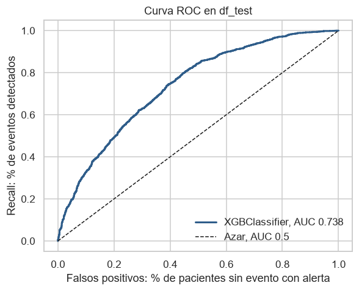

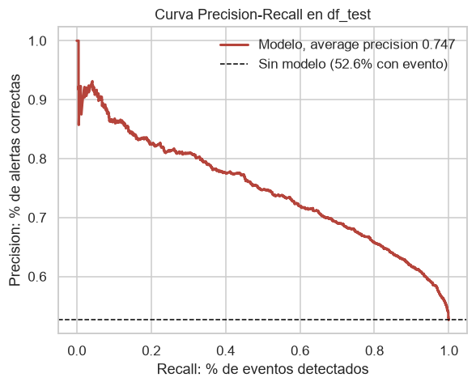

- Para detectar cerca del 80 % de los eventos hay que aceptar alertas en cerca de la mitad de los pacientes sin evento
- La precision se mantiene en 80 % o más mientras se detecta hasta cerca del 30 % de los eventos

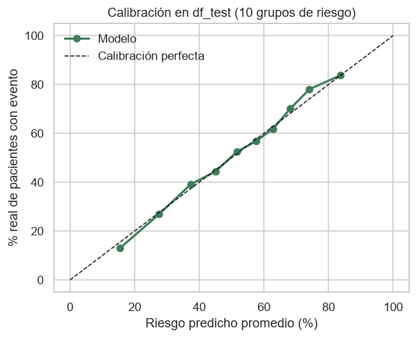

- Los puntos siguen de cerca la diagonal entre 16 % y 84 % de riesgo predicho; en los extremos hay desvíos pequeños (predice 16 % y ocurre 13 % en el grupo de menor riesgo)

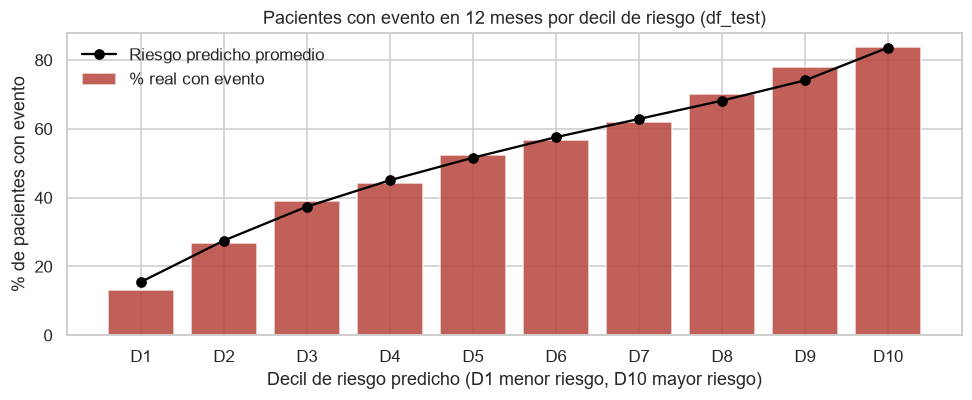

| Decil | Riesgo predicho medio | Tasa real de evento |
|---|---|---|
| D1 | 15.5 % | 13.1 % |
| D2 | 27.5 % | 26.9 % |
| D3 | 37.4 % | 39.2 % |
| D4 | 45.1 % | 44.4 % |
| D5 | 51.6 % | 52.4 % |
| D6 | 57.6 % | 56.8 % |
| D7 | 62.9 % | 61.9 % |
| D8 | 68.2 % | 70.2 % |
| D9 | 74.1 % | 78.0 % |
| D10 | 83.6 % | 83.7 % |

El decil de mayor riesgo tiene 6.4 veces más eventos que el de menor riesgo, y la tasa real sube decil a decil sin excepciones. Esto permite tres niveles: bajo (deciles 1 a 3), intermedio y alto (deciles 8 a 10).

### Desempeño por subgrupo

| Subgrupo | Pacientes | % con evento | AUC | Recall del evento |
|---|---|---|---|---|
| Menor de 18 | 1,042 | 34.5 % | 0.747 | 0.401 |
| 18 a 40 | 1,051 | 53.3 % | 0.708 | 0.695 |
| 40 a 60 | 1,332 | 59.1 % | 0.707 | 0.816 |
| Mayor de 60 | 860 | 64.0 % | 0.701 | 0.856 |
| Médula ósea | 1,236 | 35.1 % | 0.737 | 0.366 |
| Sangre periférica | 3,049 | 59.8 % | 0.710 | 0.816 |
| Trasplante 2008 a 2012 | 833 | 62.3 % | 0.758 | 0.857 |
| Trasplante 2013 a 2017 | 2,234 | 53.9 % | 0.736 | 0.742 |
| Trasplante 2018 a 2020 | 1,218 | 43.7 % | 0.719 | 0.577 |
| Sin datos vacíos | 2,532 | 60.9 % | 0.70 | 0.788 |
| 1 a 2 datos vacíos | 1,132 | 39.8 % | 0.76 | 0.590 |
| 3 o más datos vacíos | 621 | 42.2 % | 0.76 | 0.626 |

El modelo ordena bien el riesgo en todos los grupos (AUC de 0.70 a 0.76). El punto débil es el umbral: en los grupos con riesgo base bajo (niños, médula ósea, trasplantes recientes y pacientes con datos vacíos) detecta menos eventos.

## 10. Errores del modelo

| Resultado | Pacientes | Riesgo predicho medio | A menos de 10 puntos del umbral | Edad mediana | Menores de 18 | Médula ósea | Sorror mediano | Con datos vacíos | Trasplante 2018 o después |
|---|---|---|---|---|---|---|---|---|---|
| Evento detectado | 1,646 | 69.0 % | 25.3 % | 50.8 | 8.7 % | 9.7 % | 2 | 26.1 % | 18.7 % |
| Evento no detectado | 610 | 37.9 % | 46.9 % | 33.2 | 35.2 % | 45.1 % | 1 | 46.4 % | 36.9 % |
| Falsa alarma | 770 | 63.9 % | 42.9 % | 49.7 | 9.4 % | 12.9 % | 2 | 32.2 % | 26.9 % |
| Sin evento y sin alerta | 1,259 | 30.5 % | 26.6 % | 18.8 | 48.5 % | 55.8 % | 1 | 62.9 % | 38.0 % |

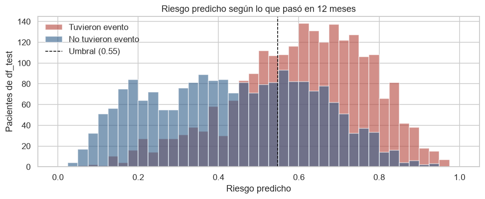

- El modelo se equivoca en 1,380 pacientes (32.2 % de df_test); el 44.6 % de esos errores tiene un riesgo a menos de 10 puntos del umbral, es decir, son casos dudosos
- Los eventos no detectados se parecen a los pacientes de bajo riesgo: más niños, más médula ósea, Sorror más bajo, más datos vacíos y más trasplantes recientes
- Las falsas alarmas se parecen a los pacientes con evento: adultos, Sorror de 2 y pocos niños
- Los errores con mucha seguridad son pocos: 139 eventos no detectados con riesgo menor a 30 % y 182 falsas alarmas con riesgo mayor a 70 %

## 11. Análisis a 6, 12 y 18 meses

El mismo pipeline, sin los pacientes de df_test y con StratifiedKFold de 5 pliegues:

| Horizonte | Pacientes | % excluidos por censura | % con evento | AUC |
|---|---|---|---|---|
| 6 meses | 24,496 | 0.07 % | 29.1 % | 0.734 ± 0.006 |
| 12 meses | 24,277 | 0.83 % | 52.6 % | 0.739 ± 0.004 |
| 18 meses | 23,589 | 3.76 % | 55.6 % | 0.741 ± 0.009 |

El AUC es casi igual en los tres horizontes, así que la elección se basa en el problema: 12 meses captura casi todos los eventos con la menor pérdida de pacientes.

## 12. Explicabilidad

### Cómo leer las contribuciones: log-odds y probabilidad

Los modelos de este tipo suman log-odds, no probabilidades: probabilidad = 1 / (1 + e^(−log-odds)). Una misma contribución mueve más el riesgo cuando el paciente está cerca del 50 %:

| Riesgo de partida | -0.5 log-odds | +0.5 log-odds |
|---|---|---|
| 10 % | 6.3 % | 15.5 % |
| 50 % | 37.8 % | 62.2 % |
| 90 % | 84.5 % | 93.7 % |

Por eso las gráficas de SHAP están en log-odds, y el notebook también traduce las contribuciones a puntos de riesgo.

### Importancia por permutación

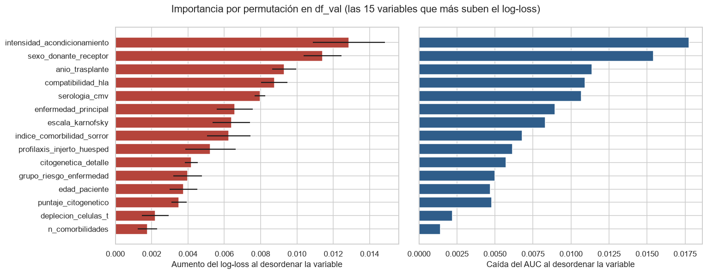

Se desordena cada variable en df_val (las 17 HLA juntas) y se mide cuánto empeora el modelo. Con los datos originales el log-loss es 0.597 y el AUC 0.743. Las que más lo empeoran: intensidad del acondicionamiento (el log-loss sube 0.013 y el AUC baja 0.018), sexo de donante y receptor, año del trasplante, compatibilidad HLA y serología de CMV. El log-loss y el AUC dan casi el mismo orden.

### SHAP

SHAP reparte la predicción de cada paciente entre sus variables. Se calcula sobre 2,000 pacientes de df_val con TreeExplainer; el valor base es 0.104 en log-odds, que equivale al 52.6 % de riesgo promedio.

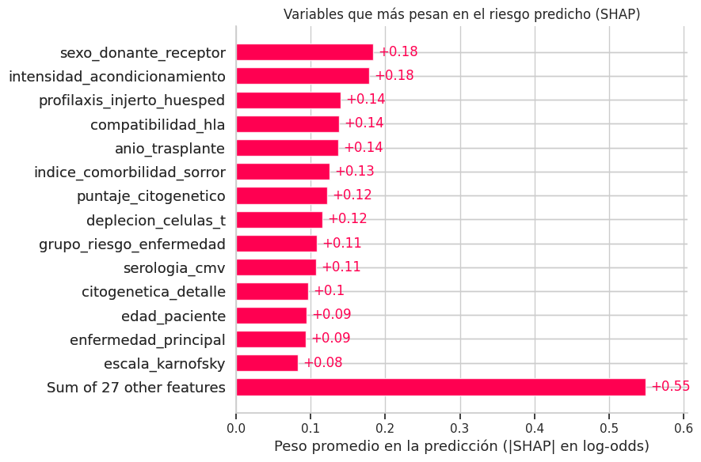

| Puesto | Variable | SHAP medio absoluto (log-odds) | Puntos de riesgo en promedio |
|---|---|---|---|
| 1 | sexo_donante_receptor | 0.189 | 3.9 |
| 2 | intensidad_acondicionamiento | 0.182 | 3.8 |
| 3 | compatibilidad_hla | 0.152 | 3.2 |
| 4 | profilaxis_injerto_huesped | 0.149 | 3.1 |
| 5 | anio_trasplante | 0.141 | 2.9 |
| 6 | puntaje_citogenetico | 0.121 | 2.5 |
| 7 | indice_comorbilidad_sorror | 0.120 | 2.4 |
| 8 | deplecion_celulas_t | 0.114 | 2.3 |
| 9 | grupo_riesgo_enfermedad | 0.112 | 2.3 |
| 10 | serologia_cmv | 0.108 | 2.2 |

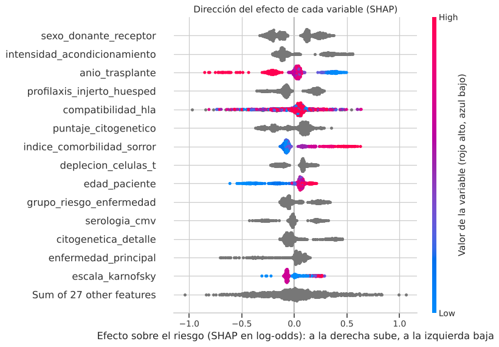

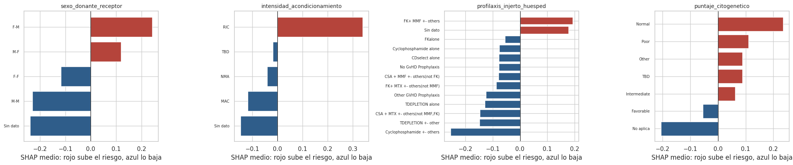

| Variable | Sube el riesgo | Baja el riesgo |
|---|---|---|
| Sexo donante y receptor | Donante mujer y receptor hombre (F-M) | Ambos hombres (M-M) |
| Intensidad del acondicionamiento | Reducida (RIC) | Intensa (MAC) o sin dato |
| Profilaxis | FK + MMF | Esquemas con ciclofosfamida, sobre todo Cyclophosphamide +- others |
| Puntaje citogenético | Normal, mal pronóstico (Poor), pendiente, otro, intermedio | Favorable y, aún más, No aplica |
| Año del trasplante | Años más antiguos | Trasplantes recientes |
| Índice de Sorror | 3 puntos o más | 0 a 2 puntos |

Efecto sobre un paciente promedio (52.6 %): un Sorror de 6 sube el riesgo 11.9 puntos (pero solo lo tienen 50 pacientes de la muestra), RIC 8.4, un citogenético normal 6.7, los trasplantes de 2008 a 2012 6.7 y la combinación F-M 6.1; la profilaxis Cyclophosphamide +- others lo baja 7.0, la combinación M-M 5.9, los trasplantes de 2017 a 2018 5.3 y el citogenético No aplica 4.9.

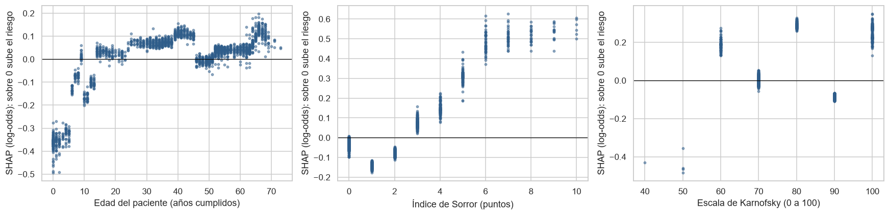

- Edad: los niños pequeños tienen la contribución más negativa; cruza el cero cerca de los 15 años y vuelve a subir cerca de los 65
- Sorror: de 0 a 2 puntos baja el riesgo, desde 3 lo sube y desde 6 se estabiliza
- Karnofsky: no hay un patrón ordenado (100 sube el riesgo y 90 lo baja), así que su efecto no debe leerse por sí solo

Hay efectos sin explicación clínica evidente (un citogenético normal sube el riesgo más que uno de mal pronóstico y una escala de Karnofsky de 100 lo sube), y el efecto del año coincide con los años de registros incompletos. Por eso SHAP explica lo que hace el modelo, no las causas del evento.

### Explicación de pacientes individuales

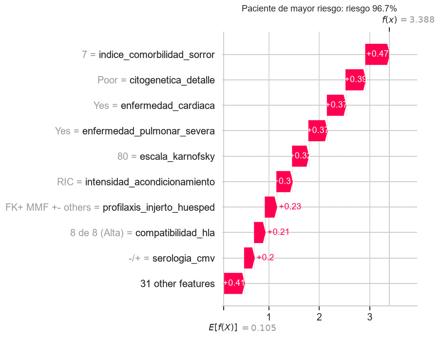

- Paciente con riesgo de 96.0 %: Sorror de 7, citogenética de mal pronóstico, acondicionamiento reducido, enfermedad cardíaca y pulmonar severa. Como ya está cerca del 100 %, quitar cualquiera de esas contribuciones le bajaría el riesgo solo entre 0.9 y 2.4 puntos

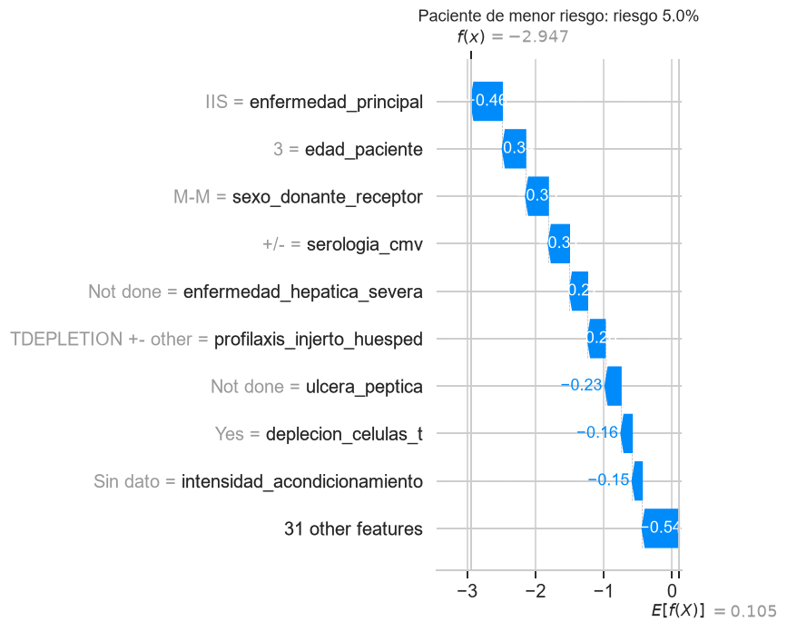

- Paciente con riesgo de 4.6 %: un niño de 11 años con enfermedad histiocítica (HIS), donante y receptor hombres, trasplantado en 2018. La enfermedad principal es la contribución más grande (4.1 puntos de riesgo menos)

## 13. Fuga de información: qué se comprobó

| Punto | Cómo se maneja |
|---|---|
| Variable objetivo | `efs`, `efs_time`, `evento_12m`, el ID, el grupo racial y la etnicidad están fuera de los 57 predictores |
| Partición | Se hace antes de cualquier paso que aprenda de los datos |
| Preprocesamiento | Imputación, escalado, One-Hot y PCA dentro del Pipeline; el PCA conserva el 95 % de la varianza en cada ajuste en lugar de fijar el número de componentes con todo df_train |
| SMOTE | Dentro de un Pipeline de imbalanced-learn, solo al entrenar |
| Columnas eliminadas por nulos | Calculadas con todo el dataset, pero sin usar el objetivo; calculadas solo con df_train dan las mismas dos variables |
| Decisiones | Imputación, PCA, SMOTE, ajuste y umbral con df_train y df_val; df_test se usa una sola vez al final |
| Modelo desplegado | Se reentrena con todos los pacientes después de medir; las métricas reportadas son las del modelo entrenado solo con df_train |

## 14. Reproducibilidad, MLflow y despliegue

- Entorno: uv con `pyproject.toml` y `uv.lock` (Python 3.12, scikit-learn 1.6.1, pandas 2.2.3, numpy 2.4.6, joblib 1.6.0, xgboost 3.4.1, imbalanced-learn 0.14.2, shap 0.54.1 y mlflow 3.18.0)
- Semilla 42 en la partición, los pliegues, los modelos, SMOTE, el bootstrap y las muestras de la explicabilidad; cada modelo usa un número fijo de hilos
- El notebook se ejecuta completo en unos 7 minutos con 20 núcleos y guarda todas las salidas
- MLflow (`mlruns/`) registra 8 runs principales con 137 anidados: datos, experimentos de imputación, PCA y SMOTE, la comparación de los seis modelos, las 120 combinaciones de GridSearchCV, el modelo final con sus métricas y gráficas, y el modelo de despliegue, registrado como `riesgo_post_trasplante`

Archivos que exporta la sección 13 a `despliegue/artefactos/`:

| Archivo | Contenido |
|---|---|
| `modelo_hct.joblib` | Pipeline completo (preprocesamiento y XGBClassifier), reentrenado con los 28,562 pacientes de df_model |
| `metadatos.json` | Umbral, métricas e intervalos de df_test, comparación de modelos, resultado del ajuste, deciles, importancias, reglas de limpieza, opciones válidas y rangos del formulario |
| `fondo_shapley.csv` | 200 pacientes de train.csv (sin `efs` ni `efs_time`) como referencia para las explicaciones |
| `pacientes_ejemplo.csv` | 5 pacientes de train.csv para probar la aplicación |
| `requirements_modelo.txt` | Versiones de las librerías con que se entrenó |

La aplicación (`despliegue/app.py`, con la lógica en `despliegue/procesamiento.py`) carga el Pipeline y aplica la misma `limpiar_datos` del notebook antes de predecir:

- Un paciente: se crea en un formulario (en blanco o a partir de un ejemplo) o se importa desde un CSV, se predice con **Predecir riesgo** y se exporta a CSV con el resultado
- Por lotes: se importa un CSV con los nombres de columnas de Kaggle o en español (o se usa `data/test.csv`), se predice con **Predecir lote** y se exportan los resultados
- Explicabilidad: valores de Shapley del modelo desplegado para cada paciente, estimados por muestreo de permutaciones con los 200 pacientes de `fondo_shapley.csv`; las contribuciones están en puntos de probabilidad y suman exactamente el riesgo del paciente

Para Streamlit Community Cloud se usa `despliegue/requirements.txt`, exportado de `uv.lock` con solo las librerías de la aplicación (pasos en el README).

## 15. Conclusiones, condiciones de validez y próximos pasos

### Resultados

- La clasificación a 12 meses responde a la decisión clínica, captura el 96.8 % de los eventos y solo excluye el 0.8 % de los pacientes; los horizontes de 6 y 18 meses dan casi el mismo AUC, pero pierden eventos o pacientes
- La imputación con el valor más frecuente redujo de 31.4 a 6.7 puntos la caída del riesgo al borrarle datos a un paciente, aunque no la elimina del todo; PCA redujo el bloque HLA de 88 a 28 columnas sin perder capacidad, y SMOTE no mejoró el resultado
- XGBClassifier fue el mejor de seis modelos (AUC 0.7349 ± 0.0062) con una ventaja significativa sobre LogisticRegression (Wilcoxon, p = 0.037); GridSearchCV eligió árboles de profundidad 2, tasa de aprendizaje 0.03 y 1,600 árboles
- En df_test logra un AUC de 0.744 (entre 0.728 y 0.758), detecta el 73.0 % de los eventos y el 68.1 % de sus alertas son correctas, con probabilidades bien calibradas; los índices clínicos por separado no pasan de 0.612
- Separa con claridad a los pacientes: 13.1 % de eventos en el decil de menor riesgo y 83.7 % en el de mayor riesgo
- Se equivoca sobre todo en casos dudosos cerca del umbral y en eventos de pacientes con perfil de bajo riesgo: niños (detecta el 40.1 % de sus eventos), injertos de médula ósea y formularios incompletos
- El riesgo depende sobre todo de la intensidad del acondicionamiento, la combinación de sexos de donante y receptor, la compatibilidad HLA, la profilaxis, el año del trasplante y la fragilidad del paciente (Sorror y edad)

### Condiciones de validez

- A qué datos aplica: pacientes de trasplante alogénico como los del registro del CIBMTR entre 2008 y 2020, con la información disponible antes del trasplante. Los datos son sintéticos: reproducen los patrones del registro, pero no son pacientes reales
- Qué garantiza: en pacientes de esa misma población, un AUC de alrededor de 0.74 (entre 0.728 y 0.758 con 95 % de confianza) y probabilidades que se pueden leer de forma casi literal
- Qué no garantiza: el desempeño en otros países, centros o años futuros (la validación no separó por fechas y los años recientes tienen registros incompletos), que el patrón de los datos vacíos se repita en otros registros, ni una lectura causal de los factores

### Próximos pasos para llevarlo a producción

- Validarlo con pacientes reales de un centro, idealmente de años recientes, y medir de nuevo el AUC y la calibración
- Recalibrarlo con datos locales y fijar un umbral propio para niños y para injertos de médula ósea
- Revisar con el equipo médico los efectos que no tienen sentido clínico antes de usar las explicaciones con pacientes
- Integrarlo con la historia clínica, vigilar en el tiempo los datos vacíos y el desempeño, y volver a entrenarlo cuando cambie la población
