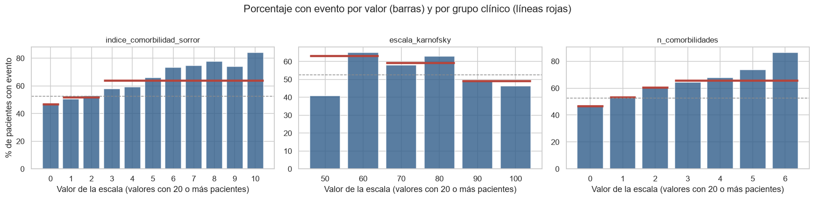

# Reporte técnico: riesgo de evento en el primer año después de un trasplante de médula ósea

Proyecto final de la materia de Aprendizaje Automático. Especialización en Inteligencia Artificial, Universidad Pedagógica y Tecnológica de Colombia.

Autor: Oscar David Perilla Dominguez (código 202624578)

Todas las cifras salen de la ejecución guardada del notebook `Proyecto_Final_ML_Riesgo_Post_Trasplante_Enviar.ipynb`, ejecutado en local con el entorno de uv, y coinciden con `despliegue/artefactos/metadatos.json` y con el registro de MLflow (`mlruns/`). Las instrucciones de instalación, ejecución y despliegue están en [README.md](README.md).

## Resumen

| Aspecto | Resultado |
|---|---|
| Pregunta | ¿Tendrá el paciente un evento adverso en los primeros 12 meses después del trasplante? |
| Datos | 28,800 pacientes y 57 variables registradas antes del trasplante (datos sintéticos de la competencia CIBMTR en Kaggle) |
| Tipo de problema | Clasificación binaria, convertida desde un problema de tiempo hasta el evento |
| Variables | 56 predictores: edades en años cumplidos, escalas como enteros, HLA con -1 si no hay dato y agrupada en cuatro niveles; el año del trasplante no se usa |
| Modelo final | XGBClassifier, el de mayor AUC de seis modelos (casi empatado con la regresión logística), ajustado con GridSearchCV |
| AUC en df_test | 0.738 (intervalo de confianza del 95 %: 0.721 a 0.752) |
| Recall y precision del evento | 66.1 % y 68.9 % con el umbral de 0.548 |
| Separación de riesgo | 12.6 % de pacientes con evento en el decil de menor riesgo frente a 84.1 % en el de mayor riesgo |
| Explicabilidad | SHAP e importancia por permutación en el notebook; valores de Shapley por paciente en la aplicación |
| Seguimiento | MLflow: experimentos, comparación de modelos, cada combinación de la búsqueda, métricas, gráficas y modelo registrado |
| Despliegue | Aplicación Streamlit, local o en Streamlit Community Cloud |

## 1. Problema

El trasplante alogénico de células hematopoyéticas (HCT, conocido como trasplante de médula ósea) reemplaza la médula enferma por células sanas de un donante. Puede curar leucemias y otras enfermedades graves de la sangre, pero más de la mitad de los pacientes tiene un evento adverso en el primer año.

Qué es el evento: el diccionario de la competencia llama a la variable resultado `efs`, supervivencia libre de eventos. Un paciente con `efs = 1` tuvo un evento grave después del trasplante (en trasplante este indicador agrupa sucesos como la recaída de la enfermedad, la falla del injerto o la muerte). `efs_time` dice cuántos meses pasaron hasta ese evento o hasta el último control.

El modelo estima el riesgo de cada paciente antes del trasplante para:

- Priorizar a los pacientes que necesitan un seguimiento más estrecho
- Revisar a tiempo alternativas de donante y de tratamiento
- Explicar al paciente y a su familia de qué depende su riesgo

### Cómo se mide el éxito

La métrica principal es el AUC-ROC, porque la decisión es a quién vigilar primero y el AUC mide justo eso: si el modelo pone primero a quien de verdad tiene más riesgo, sin depender del umbral de alerta, que se fija después.

| Métrica | Pregunta de negocio que responde |
|---|---|
| AUC-ROC | Si tomo un paciente que tuvo el evento y otro que no, ¿con qué frecuencia el modelo le da más riesgo al primero? 0.5 es lanzar una moneda y 1.0 es acertar siempre |
| Recall del evento | De cada 100 pacientes que tendrán un evento, ¿a cuántos les llega una alerta? |
| Precision del evento | De cada 100 alertas, ¿cuántas son correctas? |
| Calibración, Brier y log-loss | ¿Un riesgo de 30 % significa de verdad 3 de cada 10 pacientes? |

## 2. Datos y diccionario

- Fuente: competencia CIBMTR, Equity in post-HCT Survival Predictions, de Kaggle. Son datos sintéticos: el CIBMTR los generó a partir de su registro real para proteger la privacidad de los pacientes, así que reproducen sus patrones pero no corresponden a personas reales
- Archivos en la carpeta `data/`: `train.csv` (28,800 pacientes, 60 columnas), `data_dictionary.csv`, `test.csv` y `sample_submission.csv`
- El `test.csv` de la competencia no se usa para evaluar: trae 3 pacientes sin resultado, porque Kaggle guarda las respuestas en privado. La aplicación lo ofrece como archivo de ejemplo para la predicción por lotes
- Diccionario de variables: https://www.kaggle.com/competitions/equity-post-HCT-survival-predictions/data
- Códigos de enfermedad: https://www.manula.com/manuals/cibmtr/formsnet3-training-guide/1/en/topic/disease-codes

Ejemplos del cambio de nombres a partir del diccionario oficial:

| Nombre original | Nombre nuevo | Descripción oficial |
|---|---|---|
| `age_at_hct` | `edad_paciente` | Age at HCT |
| `comorbidity_score` | `indice_comorbilidad_sorror` | Sorror comorbidity score |
| `karnofsky_score` | `escala_karnofsky` | KPS at HCT |
| `dri_score` | `indice_riesgo_enfermedad` | Refined disease risk index |
| `conditioning_intensity` | `intensidad_acondicionamiento` | Computed planned conditioning intensity |
| `gvhd_proph` | `profilaxis_injerto_huesped` | Planned GVHD prophylaxis |
| `sex_match` | `sexo_donante_receptor` | Donor/recipient sex match |
| `hla_match_drb1_low` | `hla_drb1_baja_res` | Recipient / 1st donor antigen level (low resolution) matching at HLA-DRB1 |

Las leucemias agudas (ALL con 8,102 pacientes y AML con 7,135) y el síndrome mielodisplásico (3,046) suman más de la mitad de los pacientes.

### Variables principales en lenguaje de negocio

| Variable | Qué significa |
|---|---|
| Escala de Karnofsky | Estado funcional del paciente, de 0 a 100 en saltos de 10. 100 es una vida normal sin síntomas |
| Índice de comorbilidad de Sorror | Suma ponderada de otras enfermedades del paciente. Más puntos, más fragilidad |
| Índice de riesgo de la enfermedad | Qué tan agresiva es la enfermedad que motiva el trasplante |
| Intensidad del acondicionamiento | Qué tan fuerte es la quimioterapia o radiación previa. MAC es intensa, RIC de intensidad reducida y NMA no mieloablativa |
| Profilaxis injerto contra huésped | Medicamentos para evitar que las células del donante ataquen al paciente |
| Compatibilidad HLA | Parecido entre los marcadores genéticos del sistema inmune del paciente y del donante; el modelo la usa en cuatro niveles (Sin dato, Baja, Media y Alta) |
| Citogenética | Alteraciones en los cromosomas de las células enfermas, que indican qué tan agresiva es la enfermedad |
| Sexo donante y receptor | Combinación de sexos, por ejemplo F-M es donante mujer y receptor hombre |

## 3. Calidad y limpieza: de df_raw a df_clean


- No hay filas ni pacientes duplicados; hay 35 variables categóricas y 25 numéricas
- Dos variables superan el 50 % de nulos y se eliminan: compatibilidad de epítopos de células T (66.0 %) y enfermedad mínima residual (57.6 %)
- Variables genéticas (21): si el dato no está, lo más probable es que la prueba no se hizo, así que no se llena con un promedio. Las 17 HLA son conteos de coincidencias y quedan como números enteros con -1 cuando no hay dato (entre 8.3 % y 24.9 % de los pacientes); las 2 de citogenética y las 2 de epítopos de células T son categorías y quedan como `No aplica` (entre 28.0 % y 41.4 %)
- Edades y escalas como enteros: la edad del paciente y la del donante pasan a años cumplidos (0 a 73 y 18 a 84), y el índice de Sorror (0 a 10) y la escala de Karnofsky (40 a 100) se guardan como enteros
- Se crean cinco variables nuevas: diferencia de edad donante-paciente (entera y sin signo, de 0 a 80 años, porque mide la distancia entre las dos edades; la dirección la dan las dos edades), paciente pediátrico, número de comorbilidades, si recibió irradiación corporal total y el índice de riesgo de la enfermedad agrupado en seis grupos (Bajo, Intermedio, Alto, Muy alto, No aplica y Pendiente)
- df_clean queda con 62 columnas (60 originales, menos 2 eliminadas, más 5 nuevas, menos el índice de riesgo original)

```python
def limpiar_datos(df, columnas_eliminadas):
    df = df.rename(columns=NOMBRES).drop(columns=columnas_eliminadas, errors="ignore")
    # Genéticas de texto sin dato como No aplica
    for c in VARIABLES_GENETICAS:
        df[c] = df[c].astype(object).where(df[c].notna(), "No aplica").astype(str)
    # HLA como conteo entero con -1 cuando no hay dato
    for c in COLUMNAS_HLA:
        df[c] = pd.to_numeric(df[c], errors="coerce").fillna(-1).astype(int)
    # Edades en años cumplidos y escalas como enteros
    df[["edad_paciente", "edad_donante"]] = np.floor(df[["edad_paciente", "edad_donante"]].astype(float))
    for c in COLUMNAS_ENTERAS:
        df[c] = pd.to_numeric(df[c], errors="coerce").astype("Int64")
    # Variables nuevas
    df["dif_edad_donante"] = (df["edad_donante"] - df["edad_paciente"]).abs()
    df["es_pediatrico"] = (df["edad_paciente"] < 18).astype("Int64")
    df["n_comorbilidades"] = (df[COMORBILIDADES] == "Yes").sum(axis=1)
    irradiacion = df["irradiacion_corporal_total"]
    df["recibio_irradiacion"] = (irradiacion != "No TBI").astype("Int64").where(irradiacion.notna())
    df["grupo_riesgo_enfermedad"] = df["indice_riesgo_enfermedad"].map(GRUPO_RIESGO).fillna(df["indice_riesgo_enfermedad"])
    return df.drop(columns=["indice_riesgo_enfermedad"])
```

Todas las reglas son fijas, se aplican fila por fila y no usan la variable objetivo ni datos de otros pacientes. Los nulos que quedan (28 variables, casi todas con menos de 10 %) se imputan dentro del Pipeline. La función está en la sección 3 del notebook y una copia exacta en `despliegue/procesamiento.py`, que es la que usa la aplicación.

## 4. De tiempo hasta el evento a clasificación, y partición

El resultado original es el tiempo en meses hasta el evento, una variable continua parecida a una regresión. El problema es la censura: a muchos pacientes se les dejó de observar sin haber tenido el evento, así que no se conoce su tiempo real. Se convierte en una pregunta de sí o no:

```text
evento_12m = 1   si el paciente tuvo el evento en los primeros 12 meses
evento_12m = 0   si tuvo el evento después, o si se le siguió 12 meses o más sin evento
excluido         si no tuvo el evento pero salió del seguimiento antes de los 12 meses
```


- La decisión clínica es binaria: seguimiento intensivo o habitual
- De los 15,532 pacientes con evento, el 96.8 % lo tuvo antes de los 12 meses (mediana de 5.8 meses)
- Sin evento siguen el 70.9 % a los 6 meses, el 47.7 % a los 12 y el 46.3 % a los 18
- Solo se excluyen 238 pacientes (0.8 %); df_model queda con 28,562 pacientes y 56 predictores, 52.6 % con evento y 47.4 % sin evento
- El grupo racial, la etnicidad y el año del trasplante no se usan como predictores. El año no describe al paciente: su relación con el riesgo coincide con los años de registros incompletos (sección 5), y un modelo para pacientes nuevos no debe apoyarse en la fecha. Se conserva solo para revisar el desempeño por periodo

Partición 70/15/15, estratificada por objetivo y grupo racial, antes de cualquier paso que aprenda de los datos:

| Conjunto | Pacientes | Con evento | Sin evento | Para qué se usa |
|---|---|---|---|---|
| df_train | 19,992 | 52.62 % | 47.38 % | Experimento de representación, comparación de modelos y búsqueda de hiperparámetros con validación cruzada |
| df_val | 4,285 | 52.65 % | 47.35 % | Decisiones fuera de la validación cruzada: imputación, PCA, SMOTE, comprobación del modelo ajustado y umbral de alerta |
| df_test | 4,285 | 52.65 % | 47.35 % | Evaluación final, una sola vez |

Por qué 70/15/15 con 28,562 pacientes: df_test es lo bastante grande para medir el AUC con un margen de unos 0.015 hacia cada lado (sección 9), y df_val permite tomar varias decisiones sin usar df_test. Calculada solo con df_train, la regla de más de 50 % de nulos elimina las mismas dos variables, así que haberla calculado con todos los pacientes no le pasa información de df_val ni de df_test al modelo.

## 5. Hallazgos del análisis exploratorio

Todo el análisis usa solo df_train.


- El riesgo sube con la edad del paciente: 26 % en niños de 0 a 5 años, 53 % (el promedio) entre 31 y 36 años y 66 % en mayores de 65
- La edad del donante pesa poco hasta los 53 años y sube a entre 57 % y 60 % con donantes de 54 años o más


- Riesgo de la enfermedad alto: 66 % con evento; la categoría Muy alto queda por debajo del promedio (41 %)
- Acondicionamiento de intensidad reducida (RIC): 67 %, frente a 55 % del intenso (MAC)
- Sangre periférica: 60 %, frente a 35 % de la médula ósea
- Los pacientes sin dato (barras ocre) tienen menos riesgo que el promedio; sin dato de intensidad solo el 20 % tiene evento

### Escalas numéricas: número o grupos



| Escala | Grupos clínicos revisados | % con evento por grupo |
|---|---|---|
| Índice de Sorror (HCT-CI) | 0, 1 a 2, 3 o más | 46.9 %, 51.7 %, 64.0 % |
| Escala de Karnofsky | 60 o menos, 70 a 80, 90 a 100 | 63.3 %, 59.2 %, 49.1 % |
| Número de comorbilidades | 0, 1, 2, 3 o más | 46.7 %, 53.4 %, 60.4 %, 65.9 % |

- Sorror y el número de comorbilidades suben casi valor a valor (Sorror de 47 % con 0 puntos a 84 % con 10), así que el número ya ordena el riesgo; agruparlos junta valores muy distintos (el grupo de 3 o más va de 58 % a 84 %)
- Karnofsky no sigue un orden por valor (60 tiene 65 %, 70 tiene 58 %, 80 tiene 63 % y 50 solo 41 %), pero sus grupos clínicos sí quedan ordenados. La decisión se toma con el modelo en la sección 6

### Compatibilidad HLA


- Correlación media de 0.763 entre pares de variables HLA (mínima 0.494); las que resumen varios genes llegan a 0.99
- El 20.1 % de los pacientes tiene -1 en `hla_alta_res_8` y su porcentaje con evento (51.7 %) es casi igual al de quienes sí tienen el dato (52.9 %)
- Se revisa una versión por niveles, según el porcentaje de coincidencias sobre el máximo de cada variable (2, 6, 8 o 10): Sin dato (-1), Baja (menos de 40 %), Media (40 % a 79 %) y Alta (80 % o más). En una variable sobre 10 son 0 a 3, 4 a 7 y 8 a 10
- El nivel Alta tiene entre 52.6 % y 54.8 % con evento y el Media entre 48.4 % y 52.6 %: la compatibilidad completa no tiene menos eventos en estos datos, así que no se lee como causa. El nivel Baja tiene muy pocos pacientes (menos de 60 por variable)

### Datos vacíos y año del trasplante


- Entre 2008 y 2017 cada paciente tiene alrededor de una variable vacía de las 27 que aún pueden tener nulos; sube a 2.3 en 2018 y 4.1 en 2019. La barra de 2020 llega a 15, pero ese año solo tiene 2 pacientes en df_train
- A los pacientes pediátricos les falta la intensidad del acondicionamiento en el 47.9 % de los casos, frente al 7.4 % en adultos
- En varias enfermedades hereditarias o no malignas (IMD, IIS, IEA, HIS) el dato falta en el 78 % o más, y en el 82 % de los pocos casos de linfoma de Hodgkin; en AML, MDS o ALL en menos del 5 %. No pasa en todas: a las anomalías plaquetarias hereditarias casi nunca les falta
- No es abandono del seguimiento: los pacientes sin evento tienen entre 35.9 y 39.5 meses de seguimiento en mediana con 0 a 5 variables vacías; el grupo con 6 o más tiene 27.3 meses porque coincide con los trasplantes más recientes
- Sí es un sesgo: en los adultos, el 61.0 % de quienes tienen el dato de intensidad tuvo un evento, frente al 23.6 % de quienes no lo tienen; en los niños, 48.4 % frente a 18.9 %


- Hasta 2017 el porcentaje con evento sube y baja entre 46 % y 68 % sin una tendencia clara; en 2018 baja a 47.5 % y en 2019 a 33.0 %, los mismos años con más datos vacíos. Por eso el año del trasplante no se usa como predictor

## 6. Preparación de datos

Cada tipo de variable recibe solo el tratamiento que necesita, con clases estándar de scikit-learn dentro de un Pipeline:

| Tipo | Variables | Si falta el dato | Transformación | Columnas |
|---|---|---|---|---|
| Continuas y escalas | edad del paciente, edad del donante, diferencia de edad, Sorror, Karnofsky, número de comorbilidades | mediana | StandardScaler | 6 |
| Binarias | es_pediatrico, recibio_irradiacion | valor más frecuente | ninguna (ya son 0 y 1) | 2 |
| Categóricas | 31 variables de texto | valor más frecuente | OneHotEncoder (categorías con menos de 20 pacientes juntas) | 144 |
| HLA | 17 variables por niveles | -1 como nivel Sin dato | OneHotEncoder | 65 |

```python
columnTransformer = ColumnTransformer([
    ("hla", Pipeline([("oneHotEncoder", OneHotEncoder(handle_unknown="infrequent_if_exist", min_frequency=20, sparse_output=False))]), hla),
    ("continuas", Pipeline([("simpleImputer", SimpleImputer(strategy="median")), ("standardScaler", StandardScaler())]), continuas),
    ("binarias", SimpleImputer(strategy="most_frequent"), binarias),
    ("categoricas", Pipeline([("simpleImputer", SimpleImputer(strategy="most_frequent")),
                              ("oneHotEncoder", OneHotEncoder(handle_unknown="infrequent_if_exist", min_frequency=20, sparse_output=False))]),
     categoricas),
])
pipelineFinal = Pipeline([("columnTransformer", columnTransformer), ("modelo", XGBClassifier(...))])
```

Por qué se escala y qué se escala: las variables numéricas tienen escalas muy distintas (edad de 0 a 73, Karnofsky de 40 a 100, Sorror de 0 a 10). La regresión logística penaliza los coeficientes y KNN y PCA miden distancias, así que sin escalar pesarían más las variables de números grandes solo por su unidad. Las binarias y las columnas de OneHotEncoder ya están en 0 y 1 y no se escalan. A los árboles el escalado no les cambia nada.

Por qué todo va dentro del Pipeline: la imputación, el escalado y el OneHotEncoder aprenden algo de los datos (la mediana, la media y la desviación, las categorías). Si se ajustaran una sola vez con todos los pacientes antes de la validación cruzada, esos valores incluirían a los pacientes con los que después se mide el modelo, y el resultado saldría mejor de lo real. Dentro del Pipeline, en cada pliegue los pasos aprenden solo de los datos de entrenamiento. Agrupar los niveles HLA no aprende nada (usa cortes fijos), así que puede ir antes del Pipeline sin fuga.

### Representación: número o grupos

Cada cambio se compara con dejar todas las variables como número, con LogisticRegression y XGBClassifier en sus configuraciones de partida y validación cruzada de 5 pliegues sobre df_train. Regla: se agrupa si el cambio promedio de AUC de los dos modelos es positivo y ninguno pierde más de 0.001.

| Variante | Cambio de AUC en LogisticRegression | Cambio de AUC en XGBClassifier | ¿Se agrupa? |
|---|---|---|---|
| HLA por niveles | +0.0017 (mejora en 4 de 5 pliegues) | -0.0002 | Sí |
| Sorror agrupado | -0.0005 | -0.0004 | No |
| Karnofsky agrupado | +0.0005 | -0.0026 (empeora en los 5 pliegues) | No |
| Número de comorbilidades agrupado | -0.0002 | -0.0005 | No |

La regresión logística gana con HLA por niveles porque con el número trataría el -1 como "menos coincidencias que 0"; con los niveles el Sin dato es una categoría aparte. Karnofsky se ve más ordenado por grupos, pero XGBoost aprovecha diferencias entre valores individuales (70 frente a 80) que la agrupación junta, así que separa peor a los pacientes.

### Imputación

Cambio de riesgo con vacíos: diferencia en el riesgo promedio al borrar la intensidad del acondicionamiento, la escala de Karnofsky y el índice de Sorror a 3,447 pacientes completos de df_val.

| Modelo | SimpleImputer | AUC en df_val | Cambio de riesgo con vacíos |
|---|---|---|---|
| LogisticRegression | constant (No informado) | 0.7377 | -21.9 puntos |
| LogisticRegression | most_frequent | 0.7343 | -5.3 puntos |
| XGBClassifier | constant (No informado) | 0.7380 | -31.6 puntos |
| XGBClassifier | most_frequent | 0.7354 | -7.1 puntos |

Se elige `most_frequent`: cuesta 0.003 de AUC y reduce mucho el premio a los formularios incompletos, aunque no lo elimina del todo.

### Reducción de dimensión

| Variante | Columnas | AUC LogisticRegression | AUC XGBClassifier |
|---|---|---|---|
| Sin PCA | 217 | 0.7343 | 0.7354 |
| PCA solo en HLA (95 % de varianza) | 170 | 0.7325 | 0.7336 |
| PCA sobre todas las columnas (95 % de varianza) | 73 | 0.7283 | 0.7164 |

Con HLA ya agrupada, PCA baja el AUC en los dos modelos, así que el modelo final no usa PCA. Solo KNN lleva un PCA propio en la comparación de modelos, porque mide distancias.

### Balanceo de clases: prueba con SMOTE

Con 52.6 % y 47.4 % las clases están casi balanceadas. Se probó SMOTE dentro de un Pipeline de imbalanced-learn (solo actúa al entrenar):

| Modelo | Cambio en AUC | Cambio en F1 macro | Recall del evento sin SMOTE | Recall del evento con SMOTE |
|---|---|---|---|---|
| LogisticRegression | 0.0000 | +0.0092 | 0.750 | 0.709 |
| XGBClassifier | -0.0007 | +0.0023 | 0.754 | 0.745 |

La mejora es tan pequeña que no compensa agregar pacientes sintéticos al entrenamiento, así que no se usa SMOTE; el equilibrio entre eventos detectados y alertas se ajusta con el umbral.

## 7. Comparación de modelos

Seis modelos con el mismo Pipeline, evaluados con StratifiedKFold de 10 pliegues sobre df_train (KNN con un PCA global adicional):

- Estratificada: cada pliegue conserva la proporción de 52.6 % y 47.4 %, así todos los pliegues son comparables
- 10 pliegues: cada pliegue de validación tiene unos 2,000 pacientes, suficientes para un AUC estable, y da 10 valores por modelo para la prueba de Wilcoxon. Todos los modelos usan los mismos pliegues
- Sin partición por fechas: el objetivo no es pronosticar años futuros, y los años recientes tienen pocos pacientes y registros incompletos. Queda como limitación

| Modelo | AUC | Average precision | F1 macro | Balanced accuracy | Log-loss | Segundos por ajuste |
|---|---|---|---|---|---|---|
| XGBClassifier | 0.7309 ± 0.0075 | 0.7370 ± 0.0091 | 0.6670 ± 0.0045 | 0.6673 ± 0.0044 | 0.6046 ± 0.0060 | 4.5 |
| LogisticRegression | 0.7295 ± 0.0085 | 0.7354 ± 0.0094 | 0.6650 ± 0.0069 | 0.6650 ± 0.0068 | 0.6062 ± 0.0068 | 2.2 |
| HistGradientBoostingClassifier | 0.7244 ± 0.0075 | 0.7300 ± 0.0090 | 0.6581 ± 0.0063 | 0.6583 ± 0.0060 | 0.6096 ± 0.0060 | 14.7 |
| AdaBoostClassifier | 0.7188 ± 0.0094 | 0.7270 ± 0.0115 | 0.6536 ± 0.0120 | 0.6546 ± 0.0116 | 0.6360 ± 0.0036 | 30.3 |
| RandomForestClassifier | 0.7171 ± 0.0106 | 0.7247 ± 0.0118 | 0.6538 ± 0.0091 | 0.6549 ± 0.0087 | 0.6178 ± 0.0063 | 17.0 |
| KNeighborsClassifier | 0.6930 ± 0.0113 | 0.6962 ± 0.0144 | 0.6374 ± 0.0112 | 0.6381 ± 0.0110 | 0.6329 ± 0.0074 | 2.5 |

Los segundos por ajuste son con un hilo por modelo y los 10 pliegues en paralelo.


Prueba de Wilcoxon pareada (AUC del mejor frente a cada uno de los otros en los mismos 10 pliegues):

| Modelo comparado | Diferencia media de AUC | Pliegues en que gana XGBClassifier | p-valor |
|---|---|---|---|
| LogisticRegression | 0.0014 | 7 de 10 | 0.322 |
| HistGradientBoostingClassifier | 0.0065 | 10 de 10 | 0.002 |
| AdaBoostClassifier | 0.0121 | 10 de 10 | 0.002 |
| RandomForestClassifier | 0.0137 | 9 de 10 | 0.004 |
| KNeighborsClassifier | 0.0379 | 10 de 10 | 0.002 |

Se elige XGBClassifier por tener el mayor AUC medio y la menor log-loss, pero su ventaja sobre LogisticRegression no es significativa: los dos ordenan el riesgo casi igual, y la regresión logística queda como una alternativa real, más simple de explicar. Frente a los otros cuatro la ventaja sí es significativa.

## 8. Ajuste de hiperparámetros con GridSearchCV

El mejor modelo se ajusta con GridSearchCV. Por qué este método: se ajusta un solo modelo y cuatro hiperparámetros con pocos valores cada uno, así que probar todas las combinaciones (120) es viable; es exhaustivo y reproducible, y permite ver cómo cambia el AUC con cada hiperparámetro. Validación: StratifiedKFold de 5 pliegues sobre df_train (unos 4,000 pacientes por pliegue de validación; la mitad de ajustes que con 10).

| Hiperparámetro | Valores | Escala | Por qué |
|---|---|---|---|
| max_depth | 1, 2, 3, 4, 5 | lineal | Profundidad de cada árbol: cuántas variables puede combinar una regla. Más profundidad capta más interacciones, pero se sobreajusta con más facilidad |
| learning_rate | 0.03, 0.06, 0.12 | logarítmica (cada valor duplica al anterior) | Cuánto aporta cada árbol; su efecto es relativo |
| n_estimators | 200, 400, 800, 1,600 | logarítmica (cada valor duplica al anterior) | Número de árboles; va de la mano con learning_rate |
| min_child_weight | 1, 10 | logarítmica | Peso mínimo de pacientes en cada hoja; 1 es el valor por defecto de XGBoost y 10 obliga a reglas más generales |

`subsample` (0.9) y `colsample_bytree` (0.8) quedan fijos en la configuración de partida. Los valores extienden esa configuración (max_depth 4, learning_rate 0.05, 300 árboles) hacia los dos lados.


- Mejor combinación: 800 árboles de profundidad 2, tasa de aprendizaje 0.06 y peso mínimo por hoja de 10, con AUC de 0.7345. Las ocho mejores combinaciones quedan entre 0.7333 y 0.7345: cerca del óptimo el modelo es poco sensible a los hiperparámetros
- learning_rate y n_estimators quedaron dentro de la grilla y se compensan (0.03 con 1,600 árboles da 0.7344; 0.06 con 800, 0.7345; 0.12 con 400, 0.7340); max_depth = 2 también quedó dentro (la mejor con profundidad 3 llega a 0.7333)
- min_child_weight = 10 es el único valor en un borde, pero con 1 la misma combinación da 0.7342: una diferencia de 0.0003, muy por debajo de la variación entre pliegues (0.007)
- Con árboles poco profundos conviene una tasa de aprendizaje más alta y con árboles profundos una más baja; la peor combinación es profundidad 5 con 0.12 (0.7097)
- AUC de entrenamiento del mejor candidato: 0.7651, un sobreajuste moderado
- En df_val: AUC 0.7420 frente a 0.7370 sin ajustar; el ajuste mejora poco, como anticipaba la grilla
- Umbral de alerta por índice de Youden en df_val: 0.548 (recall 0.671, precision 0.707), fijado antes de ver df_test

## 9. Evaluación final en df_test

df_test (4,285 pacientes) se usa una sola vez, con el modelo y el umbral ya decididos.

| Métrica | Valor en df_test | Intervalo de confianza del 95 % (bootstrap, 1,000 remuestreos) |
|---|---|---|
| AUC-ROC | 0.7376 | 0.721 a 0.752 |
| Recall del evento | 0.6613 | 0.642 a 0.681 |
| Precision del evento | 0.6885 | 0.668 a 0.708 |
| Average precision | 0.7366 | |
| F1 macro | 0.6638 | |
| Balanced accuracy | 0.6643 | |
| Brier score | 0.2057 (0.25 es predecir siempre 50 %) | |
| Log-loss | 0.5970 (0.693 es predecir siempre 50 %) | |

El AUC en df_test está en línea con la validación cruzada (0.7345) y con df_val (0.7420): el resultado es estable. Frente a la versión anterior del modelo, que usaba el año del trasplante (AUC 0.744), sacar el año costó unos 0.006 de AUC.

Punto de referencia: usados por sí solos, el índice de Sorror logra un AUC de 0.569, la escala de Karnofsky 0.565 y el grupo de riesgo de la enfermedad 0.612, frente a 0.738 del modelo.


- De los 2,256 pacientes con evento, el modelo alertó a 1,492 y no detectó a 764
- De los 2,029 sin evento, 1,354 quedaron bien clasificados y 675 recibieron una alerta de más


- Para detectar cerca del 80 % de los eventos hay que aceptar alertas en cerca del 45 % de los pacientes sin evento
- La precision se mantiene en 80 % o más mientras se detecta hasta cerca del 25 % de los eventos


- Los puntos siguen de cerca la diagonal entre 16 % y 84 % de riesgo predicho; los desvíos son pequeños (predice 16 % y ocurre 13 % en el grupo de menor riesgo)


| Decil | Riesgo predicho medio | Tasa real de evento |
|---|---|---|
| D1 | 15.6 % | 12.6 % |
| D2 | 28.2 % | 28.7 % |
| D3 | 38.0 % | 33.1 % |
| D4 | 45.9 % | 50.2 % |
| D5 | 52.3 % | 56.9 % |
| D6 | 57.8 % | 56.3 % |
| D7 | 62.8 % | 64.3 % |
| D8 | 68.2 % | 65.5 % |
| D9 | 74.3 % | 74.8 % |
| D10 | 83.6 % | 84.1 % |

El decil de mayor riesgo tiene 6.7 veces más eventos que el de menor riesgo, y la tasa real sube decil a decil, salvo el 6, que queda apenas por debajo del 5. Esto permite tres niveles: bajo (deciles 1 a 3), intermedio y alto (deciles 8 a 10).

### Desempeño por subgrupo

| Subgrupo | Pacientes | % con evento | AUC | Recall del evento |
|---|---|---|---|---|
| Menor de 18 | 1,042 | 34.5 % | 0.748 | 0.331 |
| 18 a 40 | 1,121 | 53.8 % | 0.688 | 0.619 |
| 41 a 60 | 1,330 | 58.8 % | 0.704 | 0.742 |
| Mayor de 60 | 792 | 64.6 % | 0.699 | 0.820 |
| Médula ósea | 1,236 | 35.1 % | 0.733 | 0.283 |
| Sangre periférica | 3,049 | 59.8 % | 0.703 | 0.751 |
| Trasplante 2008 a 2012 | 833 | 62.3 % | 0.751 | 0.694 |
| Trasplante 2013 a 2017 | 2,234 | 53.9 % | 0.736 | 0.667 |
| Trasplante 2018 a 2020 | 1,218 | 43.7 % | 0.725 | 0.617 |
| Sin datos vacíos | 2,532 | 60.9 % | 0.687 | 0.708 |
| 1 a 2 datos vacíos | 1,132 | 39.8 % | 0.760 | 0.532 |
| 3 o más datos vacíos | 621 | 42.2 % | 0.763 | 0.607 |

El modelo ordena bien el riesgo en todos los grupos (AUC de 0.69 a 0.76). El punto débil es el umbral: en los grupos con riesgo base bajo (niños, médula ósea, trasplantes recientes y pacientes con datos vacíos) detecta menos eventos.

## 10. Errores del modelo

| Resultado | Pacientes | Riesgo predicho medio | A menos de 10 puntos del umbral | Edad mediana | Menores de 18 | Médula ósea | Sorror mediano | Con datos vacíos | Trasplante 2018 o después |
|---|---|---|---|---|---|---|---|---|---|
| Evento detectado | 1,492 | 70.5 % | 33.3 % | 51.0 | 8.0 % | 8.2 % | 2 | 26.7 % | 22.0 % |
| Evento no detectado | 764 | 41.6 % | 50.4 % | 34.5 | 31.4 % | 40.7 % | 1 | 41.1 % | 26.7 % |
| Falsa alarma | 675 | 66.3 % | 49.5 % | 50.0 | 8.1 % | 11.4 % | 2 | 32.3 % | 32.4 % |
| Sin evento y sin alerta | 1,354 | 32.5 % | 23.2 % | 22.0 | 46.4 % | 53.5 % | 1 | 60.7 % | 34.5 % |


- El modelo se equivoca en 1,439 pacientes (33.6 % de df_test); el 50.0 % de esos errores tiene un riesgo a menos de 10 puntos del umbral, es decir, son casos dudosos
- Los eventos no detectados se parecen a los pacientes de bajo riesgo: más niños, más médula ósea, Sorror más bajo y más datos vacíos
- Las falsas alarmas se parecen a los pacientes con evento: adultos, Sorror de 2 y pocos niños
- Los errores con mucha seguridad son pocos: 129 eventos no detectados con riesgo menor a 30 % y 198 falsas alarmas con riesgo mayor a 70 %

## 11. Análisis a 6, 12 y 18 meses

El mismo pipeline, sin los pacientes de df_test y con StratifiedKFold de 5 pliegues:

| Horizonte | Pacientes | % excluidos por censura | % con evento | AUC |
|---|---|---|---|---|
| 6 meses | 24,496 | 0.07 % | 29.1 % | 0.725 ± 0.006 |
| 12 meses | 24,277 | 0.83 % | 52.6 % | 0.735 ± 0.006 |
| 18 meses | 23,589 | 3.76 % | 55.6 % | 0.739 ± 0.008 |

El AUC es parecido en los tres horizontes, así que la elección se basa en el problema: 12 meses captura casi todos los eventos con la menor pérdida de pacientes.

## 12. Explicabilidad

### Cómo leer las contribuciones: log-odds y probabilidad

Los modelos de este tipo suman log-odds, no probabilidades: probabilidad = 1 / (1 + e^(−log-odds)). Una misma contribución mueve más el riesgo cuando el paciente está cerca del 50 %:

| Riesgo de partida | -0.5 log-odds | +0.5 log-odds |
|---|---|---|
| 10 % | 6.3 % | 15.5 % |
| 50 % | 37.8 % | 62.2 % |
| 90 % | 84.5 % | 93.7 % |

Por eso las gráficas de SHAP están en log-odds, y el notebook también traduce las contribuciones a puntos de riesgo.

### Importancia por permutación


Se desordena cada variable en df_val (las 17 HLA juntas) y se mide cuánto empeora el modelo. Con los datos originales el log-loss es 0.598 y el AUC 0.742. Las que más lo empeoran: intensidad del acondicionamiento (el log-loss sube 0.012 y el AUC baja 0.017), sexo de donante y receptor, enfermedad principal, compatibilidad HLA y serología de CMV. El log-loss y el AUC dan casi el mismo orden.

### SHAP

SHAP reparte la predicción de cada paciente entre sus variables. Se calcula sobre 2,000 pacientes de df_val con TreeExplainer; las 217 columnas se suman en 40 variables originales (las 17 HLA como `compatibilidad_hla`) y el valor base es 0.105 en log-odds, que equivale al 52.6 % de riesgo promedio.


| Puesto | Variable | SHAP medio absoluto (log-odds) | Puntos de riesgo en promedio |
|---|---|---|---|
| 1 | sexo_donante_receptor | 0.199 | 4.1 |
| 2 | intensidad_acondicionamiento | 0.179 | 3.8 |
| 3 | profilaxis_injerto_huesped | 0.158 | 3.3 |
| 4 | grupo_riesgo_enfermedad | 0.132 | 2.7 |
| 5 | enfermedad_principal | 0.122 | 2.4 |
| 6 | indice_comorbilidad_sorror | 0.117 | 2.3 |
| 7 | compatibilidad_hla | 0.116 | 2.4 |
| 8 | serologia_cmv | 0.111 | 2.3 |
| 9 | deplecion_celulas_t | 0.109 | 2.3 |
| 10 | puntaje_citogenetico | 0.109 | 2.3 |

Sin el año del trasplante, su peso se repartió sobre todo entre la enfermedad y su grupo de riesgo.


| Variable | Sube el riesgo | Baja el riesgo |
|---|---|---|
| Sexo donante y receptor | Donante mujer y receptor hombre (F-M) | Ambos hombres (M-M) o sin dato |
| Intensidad del acondicionamiento | Reducida (RIC) | Intensa (MAC) o sin dato |
| Profilaxis | FK + MMF | Esquemas con ciclofosfamida, sobre todo Cyclophosphamide +- others |
| Grupo de riesgo de la enfermedad | Alto (y, sin explicación clínica evidente, Bajo) | No aplica (enfermedades no malignas y pediátricos) |
| Serología de CMV | Paciente con el virus y donante sin él (-/+) | Donante con el virus y paciente sin él (+/-) |
| Índice de Sorror | 3 puntos o más | 0 a 2 puntos |

Efecto sobre un paciente promedio (52.6 %): un Sorror de 6 sube el riesgo 11.6 puntos (pero solo lo tienen 50 pacientes de la muestra), RIC 8.2, el grupo de riesgo Alto 6.8 y la combinación F-M 6.6; la enfermedad IIS lo baja 12.0 (67 pacientes), la profilaxis Cyclophosphamide +- others 8.2, la serología de CMV +/- 7.2 y la combinación M-M 6.0. En compatibilidad HLA el efecto es pequeño: el nivel Alta sube 1.2 puntos y el Sin dato baja 3.1.


- Edad: los niños pequeños tienen la contribución más negativa; cruza el cero cerca de los 13 años y vuelve a subir después de los 65
- Sorror: de 0 a 2 puntos baja el riesgo, desde 3 lo sube y desde 6 se estabiliza
- Karnofsky: no hay un patrón ordenado (100 sube el riesgo y 90 lo baja), el mismo desorden que muestran sus valores en los datos; por eso agruparla le restaba capacidad a XGBoost, y su efecto no debe leerse por sí solo

Hay efectos sin explicación clínica evidente (una escala de Karnofsky de 100 sube el riesgo, el grupo de riesgo Bajo lo sube un poco y la compatibilidad HLA completa no lo baja). Por eso SHAP explica lo que hace el modelo, no las causas del evento.

### Explicación de pacientes individuales


- Paciente con riesgo de 96.7 %: Sorror de 7, citogenética de mal pronóstico, enfermedad cardíaca y pulmonar severa, Karnofsky de 80 y acondicionamiento reducido. Como ya está cerca del 100 %, quitar cualquiera de esas contribuciones le bajaría el riesgo solo entre 0.7 y 1.9 puntos


- Paciente con riesgo de 5.0 %: un niño de 3 años con un trastorno del sistema inmune (IIS), donante y receptor hombres y serología de CMV +/-. La enfermedad principal es la contribución más grande (2.7 puntos de riesgo menos); dos comorbilidades marcadas como Not done (no evaluadas) también le bajan el riesgo, un patrón de los datos parecido al de los vacíos y no un efecto clínico

## 13. Fuga de información: qué se comprobó

| Punto | Cómo se maneja |
|---|---|
| Variable objetivo | `efs`, `efs_time`, `evento_12m`, el ID, el grupo racial, la etnicidad y el año del trasplante están fuera de los 56 predictores |
| Partición | Se hace antes de cualquier paso que aprenda de los datos |
| Limpieza y agrupación | Reglas fijas fila por fila (enteros, -1 en HLA, diferencia de edad, niveles HLA con cortes fijos) que no aprenden nada de otros pacientes |
| Preprocesamiento | Imputación, escalado y OneHotEncoder dentro del Pipeline: en cada pliegue aprenden solo de los datos de entrenamiento |
| SMOTE | Dentro de un Pipeline de imbalanced-learn, solo al entrenar |
| Columnas eliminadas por nulos | Calculadas con todo el dataset, pero sin usar el objetivo; calculadas solo con df_train dan las mismas dos variables |
| Decisiones | Representación con validación cruzada en df_train; imputación, PCA, SMOTE, ajuste y umbral con df_train y df_val; df_test se usa una sola vez al final |
| Modelo desplegado | Se reentrena con todos los pacientes después de medir; las métricas reportadas son las del modelo entrenado solo con df_train |

## 14. Reproducibilidad, MLflow y despliegue

- Entorno: uv con `pyproject.toml` y `uv.lock` (Python 3.12, scikit-learn 1.6.1, pandas 2.2.3, numpy 2.4.6, joblib 1.6.0, xgboost 3.4.1, imbalanced-learn 0.14.2, shap 0.54.1 y mlflow 3.18.0)
- Semilla 42 en la partición, los pliegues, los modelos, SMOTE, el bootstrap y las muestras de la explicabilidad; cada modelo usa un hilo y la validación cruzada y la búsqueda usan todos los núcleos (`n_jobs=-1`)
- El notebook se ejecuta completo en unos 9 minutos con 20 núcleos y guarda todas las salidas
- MLflow (`mlruns/`) registra en esta ejecución 9 runs principales con 150 anidados: datos, experimentos de representación, imputación, PCA y SMOTE, la comparación de los seis modelos, las 120 combinaciones de GridSearchCV, el modelo final con sus métricas y gráficas, y el modelo de despliegue, registrado como la versión 2 de `riesgo_post_trasplante` (la versión 1 es la del modelo anterior, que usaba el año del trasplante)

Archivos que exporta la sección 13 a `despliegue/artefactos/`:

| Archivo | Contenido |
|---|---|
| `modelo_hct.joblib` | Pipeline completo (preprocesamiento y XGBClassifier), reentrenado con los 28,562 pacientes de df_model |
| `metadatos.json` | Umbral, métricas e intervalos de df_test, comparación de modelos, resultado del ajuste, deciles, importancias, reglas de limpieza, variables agrupadas, tratamiento de cada tipo de columna, opciones válidas y rangos del formulario |
| `fondo_shapley.csv` | 200 pacientes de train.csv (sin `efs` ni `efs_time`) como referencia para las explicaciones |
| `pacientes_ejemplo.csv` | 5 pacientes de train.csv para probar la aplicación |
| `requirements_modelo.txt` | Versiones de las librerías con que se entrenó |

La aplicación (`despliegue/app.py`, con la lógica en `despliegue/procesamiento.py`) carga el Pipeline y aplica la misma `limpiar_datos` y la misma agrupación de HLA del notebook antes de predecir; al cargar comprueba que sus listas de variables coincidan con `metadatos.json`:

- Un paciente: se crea en un formulario (en blanco o a partir de un ejemplo) o se importa desde un CSV, se predice con **Predecir riesgo** y se exporta a CSV con el resultado. Las edades se piden en años cumplidos y el año del trasplante ya no se pide
- Por lotes: se importa un CSV con los nombres de columnas de Kaggle o en español (o se usa `data/test.csv`), se predice con **Predecir lote** y se exportan los resultados
- Explicabilidad: valores de Shapley del modelo desplegado para cada paciente, estimados por muestreo de permutaciones con los 200 pacientes de `fondo_shapley.csv`; las contribuciones están en puntos de probabilidad y suman exactamente el riesgo del paciente

Para Streamlit Community Cloud se usa `despliegue/requirements.txt`, exportado de `uv.lock` con solo las librerías de la aplicación (pasos en el README).

## 15. Conclusiones, condiciones de validez y próximos pasos

### Resultados

- La clasificación a 12 meses responde a la decisión clínica, captura el 96.8 % de los eventos y solo excluye el 0.8 % de los pacientes; los horizontes de 6 y 18 meses dan un AUC parecido, pero pierden eventos o pacientes
- Las variables quedan como en la práctica: edades en años cumplidos, diferencia de edad entera y sin signo, escalas como enteros, HLA con -1 cuando la prueba no se hizo y el año del trasplante fuera del modelo
- Cada tipo de variable recibe solo el tratamiento que necesita: las continuas y escalas se imputan con la mediana y se escalan, las binarias quedan en 0 y 1, las categóricas pasan por OneHotEncoder y HLA se agrupa en cuatro niveles. Agrupar HLA mejoró a la regresión logística sin costarle a XGBoost; agrupar Sorror, Karnofsky o el número de comorbilidades no mejoró a ningún modelo
- La imputación con el valor más frecuente redujo de 31.6 a 7.1 puntos la caída del riesgo al borrarle datos a un paciente, aunque no la elimina del todo; con HLA agrupada PCA ya no ayuda y no se usa, y SMOTE no mejoró el resultado
- XGBClassifier tuvo el mayor AUC de seis modelos (0.7309 ± 0.0075), pero su ventaja sobre LogisticRegression no es significativa (Wilcoxon, p = 0.322); GridSearchCV eligió 800 árboles de profundidad 2, tasa de aprendizaje 0.06 y al menos 10 pacientes por hoja
- En df_test logra un AUC de 0.738 (entre 0.721 y 0.752), detecta el 66.1 % de los eventos y el 68.9 % de sus alertas son correctas, con probabilidades bien calibradas; los índices clínicos por separado no pasan de 0.612
- Separa con claridad a los pacientes: 12.6 % de eventos en el decil de menor riesgo y 84.1 % en el de mayor riesgo
- Se equivoca sobre todo en casos dudosos cerca del umbral y en eventos de pacientes con perfil de bajo riesgo: niños (detecta el 33.1 % de sus eventos), injertos de médula ósea y formularios incompletos
- El riesgo depende sobre todo de la intensidad del acondicionamiento, la combinación de sexos de donante y receptor, la profilaxis, la enfermedad y su grupo de riesgo, la compatibilidad HLA y la fragilidad del paciente (Sorror y edad)

### Condiciones de validez

- A qué datos aplica: pacientes de trasplante alogénico como los del registro del CIBMTR entre 2008 y 2020, con la información disponible antes del trasplante. Los datos son sintéticos: reproducen los patrones del registro, pero no son pacientes reales
- Qué garantiza: en pacientes de esa misma población, un AUC de alrededor de 0.74 (entre 0.721 y 0.752 con 95 % de confianza) y probabilidades que se pueden leer de forma casi literal
- Qué no garantiza: el desempeño en otros países, centros o años futuros (la validación no separó por fechas y los años recientes tienen registros incompletos), que el patrón de los datos vacíos se repita en otros registros, ni una lectura causal de los factores

### Próximos pasos para llevarlo a producción

- Validarlo con pacientes reales de un centro, idealmente de años recientes, y medir de nuevo el AUC y la calibración
- Comparar en esos datos XGBoost con la regresión logística, que aquí rinde casi igual y es más fácil de explicar
- Recalibrarlo con datos locales y fijar un umbral propio para niños y para injertos de médula ósea
- Revisar con el equipo médico los efectos que no tienen sentido clínico antes de usar las explicaciones con pacientes
- Integrarlo con la historia clínica, vigilar en el tiempo los datos vacíos y el desempeño, y volver a entrenarlo cuando cambie la población
